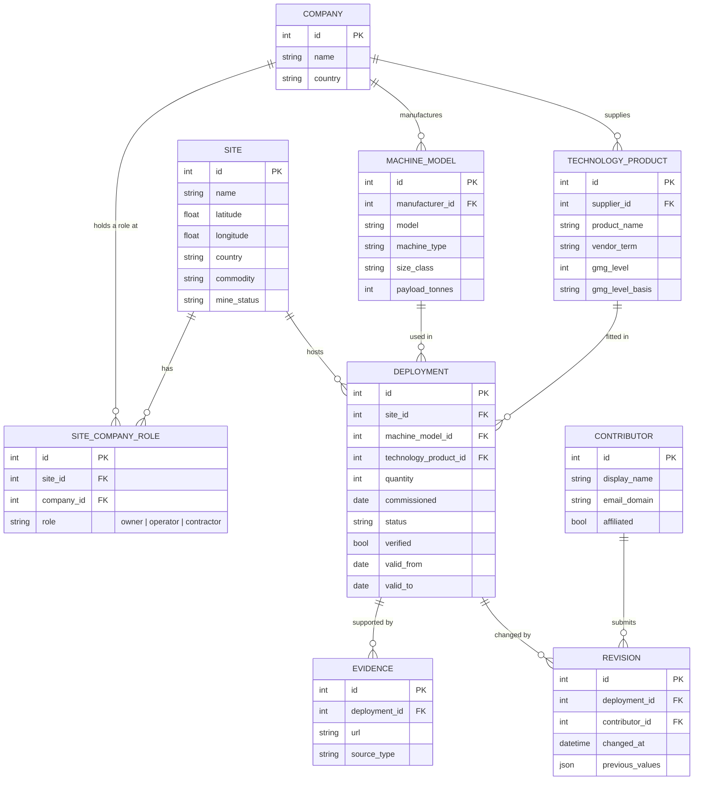

# Software Requirements Specification

## Autonomous Mining Equipment Market Map

| | |
|---|---|
| **Version** | 0.1 — draft for team review and client confirmation |
| **Date** | 10 August 2026 |
| **Client** | Dr Adrian Boeing, UWA |
| **Representative user** | RCT Global |
| **Unit** | CITS5206 Capstone Project, Semester 2 2026 |
| **Prepared by** | Group 5 — Hengan Weng (24201874), Shee Wang (24368932), Zerun Zhang (24389925), Hans Lionar (24661999), Zunhao Zhang (24758673), Tyrone Tran (24814799) |

### Revision history

| Version | Date | Author | Change |
|---|---|---|---|
| 0.1 | 10 Aug 2026 | Group 5 | Initial draft, from the client meeting of 6 August, the facilitator meeting of 7 August, and the written project brief |

### Requirement status convention

Every requirement carries a status. This distinguishes what the client has stated from what the team has inferred, and prevents assumptions being mistaken for agreement.

| Status | Meaning |
|---|---|
| ✅ **Confirmed** | Stated by the client. Source referenced, using the codes defined in Section 1.4. |
| ❓ **Assumed** | Inferred by the team. Carries no client source. Each is mapped to an open question in Appendix A. |

Priority uses MoSCoW: **M** must have · **S** should have · **C** could have · **W** won't have this semester.

---

# 1. Introduction

## 1.1 Purpose

This document specifies the requirements for the Autonomous Mining Equipment Market Map, a web application that catalogues autonomous and teleremote mining equipment deployed worldwide. It is intended for the project team, the client, and the unit facilitator, and serves as the reference against which the delivered system is assessed.

## 1.2 Scope

The system is a **web-based, crowdsourced, queryable geospatial database** of autonomous mining equipment. It comprises:

- a **map** presenting deployments geographically,
- an **analytics view** presenting market-level trends,
- a **queryable equipment register** with data export,
- a **contribution mechanism** allowing industry participants to submit and correct records, with a verification state attached to each record.

The system does not perform mine planning, fleet management, or any operational control function. It is a reference dataset and presentation layer.

**The problem it addresses.** Data on autonomous mining equipment is closed and commercially held. Market reports exist but cost in the order of $50,000–$100,000 per report, placing them beyond the reach of startups, small suppliers and academic researchers (CM1). No open dataset was found to exist (CM1). The project's purpose is to create that dataset and return the information to the public domain.

## 1.3 Definitions and abbreviations

### Automation terminology

These terms are the subject of open question Q-1 and are defined further in Section 2.6.

| Term | Definition |
|---|---|
| **Autonomous machine** | A machine intended to operate in autonomous mode during its normal operating cycle (ISO 17757:2019). |
| **Autonomous mode** | A mode in which the machine performs all safety-critical and mining functions related to its defined operations without operator interaction (ISO 17757:2019). |
| **Semi-autonomous machine** | A machine that operates autonomously during part of its cycle and requires active operator control to complete some tasks (ISO 17757:2019). |
| **Remote control** | Operator control of a machine from a device not located on the machine (ISO 17757:2019). |
| **Teleremote** | Industry term, not defined by ISO. Remote operation from a control station using camera and telemetry feeds, without line of sight. An operator is still driving the machine. |
| **Line of sight remote** | Remote operation where the operator can directly see the machine. |
| **ODD** | Operational design domain. The conditions under which an automated system is designed to function. |
| **Operator-to-machine ratio** | The number of machines a single operator controls. A commercial distinction between vendor product tiers; not recorded as a field. |

### Equipment and operations

| Term | Definition |
|---|---|
| **AHS** | Autonomous Haulage System. An automated haul truck fleet. |
| **Haul truck** | Large off-highway truck carrying ore or waste from the pit. |
| **LHD** | Load-Haul-Dump machine, also called a scoop tram. The common underground loader. |
| **Ultra class** | Haul truck size class, generally 290 t payload and above. |
| **Dozer** | Tracked or wheeled machine for pushing material. |
| **Excavator / shovel** | Machine that loads material into haul trucks. |
| **Drill rig** | Machine that drills blastholes for explosives, or drills underground development. |
| **Scaling machine** | Underground machine that removes loose rock from tunnel walls and roof. |
| **Shotcrete machine** | Underground machine that sprays concrete to support tunnel walls. |
| **Tramming** | Driving a machine between locations, as distinct from loading or dumping. |
| **Payload** | The mass a machine is rated to carry. |
| **Retrofit** | Fitting an automation system to a machine that was manufactured without it. |
| **Open pit / surface mining** | Mining from the surface. |
| **Underground mining** | Mining via shafts and tunnels. Considerably more varied in machine types than surface mining. |

### Commercial and organisational

| Term | Definition |
|---|---|
| **OEM** | Original equipment manufacturer. The company that built the machine, e.g. Caterpillar, Komatsu, Liebherr. |
| **Technology supplier** | The company supplying the automation system, frequently **not** the machine manufacturer. |
| **Mining contractor** | A company engaged to operate a site or its equipment on behalf of the owner. A substantial part of the market. |
| **Joint venture** | Shared ownership of a site by two or more companies. Common, and the reason site ownership is many-to-many. |
| **Tenement** | The legal title granting rights to mine an area. |
| **Commodity** | The material extracted — iron ore, coal, gold, copper, lithium. |
| **Commissioning** | The period during which a site or machine is brought into service before full operation. |
| **FMS** | Fleet management system. Dispatch and production software, e.g. Wenco, Modular Mining. Distinct from automation. |
| **CAGR** | Compound annual growth rate. |

### Project and document terms

| Term | Definition |
|---|---|
| **Deployment** | The central record of this system. A quantity of one machine model, at one site, fitted with one technology product, from a given date. |
| **Technology product** | A named automation system, e.g. Cat Command for Hauling, Sandvik AutoMine, RCT ControlMaster. |
| **Verified / unverified** | Whether a record's supporting evidence has been reviewed and accepted. |
| **Site status** | Whether the mine itself is operating or under commissioning. Distinct from deployment status. |
| **Deployment status** | Whether a particular quantity of automated equipment at a site is announced, being commissioned, operational or decommissioned. |

## 1.4 References

| Ref | Document |
|---|---|
| BRIEF | Autonomous Mining Equipment Market Map — client project description — https://teaching.csse.uwa.edu.au/units/capstone/projects/submit-preference/8/ |
| CM1 | Client Meeting 1 minutes and transcript, 6 August 2026 |
| FM1 | Facilitator Meeting 1 minutes and transcript, 7 August 2026 |
| REF-1 | AV Map — https://avmap.io/ (reference site nominated by client) |
| REF-2 | Brad Templeton, Autonomy Map — https://www.templetons.com/brad/robocars/autonomap.html (reference site nominated by client) |
| REF-3 | CSRankings — https://csrankings.org/ (crowdsourced submission model nominated by client) |
| STD-1 | ISO 17757:2019 — *Earth-moving machinery and mining: autonomous and semi-autonomous machine system safety*. Catalogue entry: https://www.iso.org/standard/76126.html · Terms and definitions, Online Browsing Platform: https://www.iso.org/obp/ui/en/#iso:std:iso:17757:ed-2:v1:en |
| STD-2 | Global Mining Guidelines Group, *Guideline for the Implementation of Autonomous Systems in Mining*, version 2, 2024. Section 2.1, Figure 1 *Mining Automation Maturity Model*, p. 7 — https://gmggroup.org/wp-content/uploads/2024/08/GUIDELINE_Implementation-of-Autonomous-Systems-1.pdf |
| STD-3 | SAE International J3016_201806, *Taxonomy and Definitions for Terms Related to Driving Automation Systems for On-Road Motor Vehicles*, 2018 — the taxonomy GMG adapted — https://www.sae.org/standards/content/j3016_201806/ |

## 1.5 Document overview

Section 2 describes the product context, users and constraints. Section 3 specifies external interfaces. Section 4 specifies functional requirements and Section 5 the logical data structure. Section 6 specifies non-functional requirements. Section 7 records what is deliberately out of scope. Section 8 records assumptions and dependencies.

Appendix A lists the open questions requiring client confirmation, with the hosting environment checklist. Appendix B is a checklist for recording the client's confirmation of scope.

Each requirement records its source in the tables. Sources are the client meeting of 6 August 2026, the facilitator meeting of 7 August 2026, and the written project brief.

---

# 2. Overall description

## 2.1 Product perspective

The system is a new, self-contained web application with no dependency on existing systems and no predecessor. No comparable open dataset exists (CM1).

It draws design precedent from two reference sites nominated by the client (REF-1, REF-2), both of which map autonomous vehicle deployments on public roads, and from CSRankings (REF-3) for its crowdsourced submission model.

## 2.2 Product functions

The client characterised the system as three parts (CM1):

| Part | Function |
|---|---|
| **Map** | Orientation and browsing. A user unfamiliar with the domain explores the map and learns from it. |
| **Analytics** | Large-scale market trends only — growth rates, supplier distribution, breakdowns by manufacturer, owner and region. |
| **Data export** | Extraction of the dataset so users can perform their own analysis externally. |

A fourth function is implied by the data source: **contribution**, since the dataset is to be built by crowdsourcing rather than supplied.

## 2.3 User characteristics

| User class | Description | Primary needs |
|---|---|---|
| **Academic / researcher** | Including the client. Studies market and technology trends. | Which automation products are being adopted, and how that is shifting. Raw data for independent analysis. |
| **Startup** | Evaluating whether a product idea has a market. | General market data: which segments and regions are saturated, which are open. |
| **Established technology supplier** | e.g. RCT Global. Sells automation systems. | Market opportunity and competitive position by region. |
| **Contributor** | Industry participant adding or correcting records. Often site-level personnel. | Fast, low-friction submission. Frequently possesses accurate figures with no published source. |
| **Administrator** | Client or delegate. | Review and verification of submissions; correction of erroneous records; maintenance of reference data such as automation levels held against technology products. |

Casual users with no specific goal are not treated as a separate class; their needs are met by the map without additional requirements.

## 2.4 Constraints

| ID | Constraint | Source |
|---|---|---|
| C-01 | The application must be deployable within a UWA IT environment as far as practical. | BRIEF |
| C-02 | Data is to be published openly under a Creative Commons licence. | BRIEF |
| C-03 | Technology stack is the team's choice, subject to C-01. | BRIEF |
| C-04 | Delivery is bounded by the Semester 2 2026 academic calendar and the team's available hours. | FM1 |
| C-05 | No seed dataset exists at project start. The client will supply generic data extracted from a market report, and has approached BHP, Rio Tinto and RCT; he expects perhaps two of three to provide data, and timing is uncertain. | CM1 |
| C-06 | Contributed data will vary widely in completeness. Corporate sources are expected to provide high-level data only. | CM1 |

## 2.5 Operating environment

Modern desktop web browser. No installation, no mobile application, no offline mode in this release.

## 2.6 Automation classification — proposed, not confirmed

**Why the dataset requires an automation attribute.** The brief does not list automation level among the fields to be collected, but two functions depend on it: determining what equipment is in scope, and filtering and grouping records in the map and analytics views. It is therefore held as a derived attribute of the technology product rather than a value collected from contributors.

> **Status: ❓ To be confirmed with the client (Q-1).** No classification has been agreed.

There is **no single industry convention.** Two frameworks are recognised, and vendors use a third vocabulary of their own.

### Framework A — ISO 17757:2019

*Earth-moving machinery and mining: autonomous and semi-autonomous machine system safety* (STD-1). Terminology, oriented to safety. Terms and definitions are viewable without purchase on the ISO Online Browsing Platform: <https://www.iso.org/obp/ui/en/#iso:std:iso:17757:ed-2:v1:en>

| Term | Meaning |
|---|---|
| Autonomous machine | Operates in autonomous mode during its normal operating cycle |
| Semi-autonomous machine | Autonomous for part of the cycle; operator control required for some tasks |
| Remote control | Operator control from a device not on the machine |

"Teleremote" does not appear in the standard.

### Framework B — GMG *Implementation of Autonomous Systems*, v2 (2024)

The mining industry's own guideline, published by the Global Mining Guidelines Group (STD-2). Its maturity model is **adapted from the SAE International (2018) taxonomy of driving automation (STD-3) and expressed in ISO 17757 terminology** (STD-2, Section 2.1). Full text: <https://gmggroup.org/wp-content/uploads/2024/08/GUIDELINE_Implementation-of-Autonomous-Systems-1.pdf>

| Level | Name | Definition (abridged from the guideline) | Band |
|---|---|---|---|
| **0** | No automation or autonomy | Entirely manual. Operator completes all tasks. | Manual |
| **1** | Operator assistance | Some function-specific automated features. The operator completes most tasks and maintains control. | Semi-autonomous |
| **2** | Partial automation | The system controls multiple functions within a set of defined operations. The operator performs other tasks and is generally responsible for situation awareness. | Semi-autonomous |
| **3** | Full automation | The system completes continuous operations autonomously, including situation awareness in the designated autonomous area. It identifies when intervention is needed and enters a halted state. **The operator performs the fallback.** | Autonomous |
| **4** | Partial autonomy | As level 3, but **the system performs the fallback** within a limited ODD, halting only in higher-risk situations. The supervisor may request disengagement. | Autonomous |
| **5** | Full autonomy | The system fully controls the machine, performs the fallback, and covers the same use cases as an operator within the same ODD. | Autonomous |

Note the ordering: **"Full automation" (3) sits below "Partial autonomy" (4)**. The distinction is not capability but responsibility for the fallback — at level 3 the operator recovers a halted machine; at level 4 the system recovers itself.

The figure groups the levels into three bands: **Manual** (level 0), **Semi-autonomous** (levels 1–2), and **Autonomous** (levels 3–5). It also defines operation-level stages beneath them: **manual operation**, **hybrid operation** (a mixed fleet), and **highly autonomous operation**.

Source: STD-2, Section 2.1, Figure 1 *Mining Automation Maturity Model*, page 7. Definitions in the table above are abridged from that figure.

> ⚠️ **Caveat on applicability.** The guideline describes the model as reflecting "the overall operation's level of autonomy" while also stating that levels are "assigned to mining equipment". Its primary intent appears to be operational maturity rather than per-machine classification. Applying it per technology product, as proposed below, is a reasonable adaptation but should be confirmed.

### Framework C — vendor vocabulary

Line of sight remote · teleremote · semi-automation · autonomous. Used in product marketing and by the representative user. Not standardised, but the language contributors will actually recognise.

The mapping below is the team's proposed reading of these terms against Framework B. It is an illustration of the method, not a classification of any named product, and requires confirmation.

| Vendor term | Meaning in practice | Proposed GMG level | Band |
|---|---|---|---|
| Line of sight remote | Operator drives the machine by radio while watching it directly | 0 | Manual |
| Teleremote | Operator drives the machine from a remote station using onboard cameras and sensors | 0–1 | Manual / semi-autonomous |
| Semi-automation / assisted | The system controls defined functions; the operator supervises and intervenes | 1–2 | Semi-autonomous |
| Autonomous | The system completes the operating cycle unattended within a designated area | 3–5 | Autonomous |

Note that remote operation, however sophisticated the control room, does not by itself raise the automation level: the operator is still performing the task. This is the point at which the vendor vocabulary and the standards diverge most sharply, and it bears directly on Q-1 — whether teleremote equipment is in scope.

### Proposal

**1. The technology product name is the primary fact.** It is what a contributor knows and what a published source states, and it is the system's principal subject: which automation technology is fitted to a machine, and which company supplied it (CM1). Automation level is a derived grouping attribute, not a collected value.

**2. Levels are assigned per product, by an administrator, as products are encountered.** The full population of automation products cannot be enumerated in advance — a realistic estimate is fifty or more, once vendor tiers and underground categories are counted. A product is therefore created when a contributor first names it, and classified by an administrator during review. The level is nullable, so an unclassified product does not block a record from being accepted. A contributor never classifies a machine and is never shown a level during submission.

**3. Attributes are recorded against the technology product**, not the deployment: the vendor term as published, the assigned level, and the basis on which it was assigned. Specified in FR-13 and modelled in Section 5.

**4. Scope is limited to equipment with an automation product fitted.** Entirely manual equipment is excluded, since it comprises effectively the whole global fleet and is neither collectable nor within the product's purpose. Specified in FR-12; the boundary itself is Q-1.

---

# 3. External interface requirements

## 3.1 User interfaces

Four primary screens. Static mockups exist for each (see `docs/ui/`), and are indicative of structure rather than final visual design.

| Screen | Contents |
|---|---|
| **Map** | Geospatial view with filter panel, markers distinguished by deployment status, and a detail panel showing the selected site and its deployments — machine model, quantity, technology supplier, automation level and commissioning date. |
| **Data → Analytics** | Headline statistics strip, market trend charts. |
| **Data → Equipment** | Filterable record table with export and per-record edit. |
| **Contribute** | Submission form. |

Navigation is three top-level tabs — Map, Data, Contribute — with Analytics and Equipment as sub-views of Data.

## 3.2 Hardware interfaces

None. The system does not interface with machinery, sensors or on-site equipment.

## 3.3 Software interfaces

| Interface | Purpose | Status |
|---|---|---|
| Identity provider (Microsoft, Google) via OpenID Connect | Optional contributor sign-in and email domain confirmation | ❓ Proposed |
| Geocoding service | Resolving new mine site locations to coordinates | ❓ Proposed |

No commercial map tile service is required. The base map is drawn from a static public-domain vector dataset of coastlines and borders, which is sufficient at the zoom levels this system uses — mine sites are remote, and street-level detail serves no purpose here. A tile provider would be required only if street-level zoom were needed.

## 3.4 Communications interfaces

All traffic between browser and server uses HTTPS. Requests to external services — map tiles, identity providers, and any search or language-model service — likewise use HTTPS. No other network protocol is required.

---

# 4. Functional requirements

## 4.1 Data model

| ID | Requirement | Pri | Status | Source |
|---|---|---|---|---|
| FR-01 | The system shall record equipment instances linked to a mine site, with manufacturer, model, machine type, quantity and automation level. | M | ✅ | CM1, BRIEF |
| FR-02 | The system shall record the base machine manufacturer and the technology supplier as separate, independently queryable values. | M | ✅ | CM1, BRIEF |
| FR-03 | The system shall record any number of companies against a mine site, each with a stated role of owner, operator or contractor. | M | ✅ | CM1 |
| FR-04 | The system shall record mine sites with name, coordinates, commodity, and the operating status of the mine itself, which is distinct from the status of any deployment at that site. Associated companies are recorded per FR-03. | M | ✅ | CM1 |
| FR-05 | The system shall support hierarchical grouping: machine → mine site → region → company. | S | ✅ | CM1, BRIEF |
| FR-06 | The system shall record machine size class, maximum payload and operating weight. | S | ✅ | CM1, BRIEF |
| FR-07 | The system shall record the commissioning date of each deployment. | M | ✅ | CM1, BRIEF |
| FR-08 | The system shall mark equipment as decommissioned rather than deleting it, and create a new record where equipment relocates. | S | ✅ | CM1 |
| FR-09 | The system shall record valid-from and valid-to dates to support historical views. | C | ❓ | Implied by FR-19 |
| FR-10 | The system shall support surface and underground machine types, including haul trucks, LHDs, dozers, drills, scalers and shotcrete machines. | M | ✅ | CM1 |
| FR-11 | The system shall accept a record where the defined minimum field set is present, with all other fields optional. | M | ✅ | CM1, C-06 |
| FR-12 | The system shall accept records only for equipment to which an automation product is fitted. | M | ❓ | Team proposal, Section 2.6 — see Q-1 |
| FR-13 | The system shall hold automation level, vendor term and level basis against the technology product, editable only by an administrator. | M | ❓ | Team proposal, Section 2.6 |

## 4.2 Map

| ID | Requirement | Pri | Status | Source |
|---|---|---|---|---|
| FR-14 | The system shall display a map with one marker per mine site at its geographic location. | M | ✅ | CM1 |
| FR-15 | Each site marker shall visually distinguish the site's deployment status as one of: announced, commissioning, operational, decommissioned. | M | ✅ | CM1, REF-2 |
| FR-16 | Selecting a marker shall display the site and the deployments recorded against it. | M | ✅ | CM1 |
| FR-17 | The map shall be filterable by technology supplier. | M | ✅ | CM1 |
| FR-18 | The map shall be filterable by country, machine type and automation level. | C | ❓ | Team extension of FR-17 |
| FR-19 | The map shall provide a time control showing how deployments accumulated over time. | S | ✅ | CM1, REF-1 |

## 4.3 Analytics

| ID | Requirement | Pri | Status | Source |
|---|---|---|---|---|
| FR-20 | The system shall display headline statistics: total automated machines recorded, total sites, and countries covered. | M | ✅ | CM1 |
| FR-21 | The system shall display, for each country, the compound annual growth rate of the cumulative number of machines in service, derived from deployment commissioning and decommissioning dates. | M | ✅ | CM1 |
| FR-22 | The system shall display distribution of deployments by technology supplier. | M | ✅ | CM1 |
| FR-23 | The system shall display distribution of deployments by machine manufacturer, by country, and by company role, each role aggregated separately. | S | ✅ | CM1 |
| FR-24 | The analytics view shall report the aggregate measures specified in FR-20 to FR-23 only. Analysis of individual records is served by the register and by data export. | M | ✅ | CM1 |

## 4.4 Equipment register and export

| ID | Requirement | Pri | Status | Source |
|---|---|---|---|---|
| FR-25 | The system shall provide a searchable, filterable and sortable register of equipment records. | M | ✅ | BRIEF |
| FR-26 | The system shall export the dataset in a flattened tabular format suitable for external analysis. | M | ✅ | CM1 |

## 4.5 Contribution and verification

| ID | Requirement | Pri | Status | Source |
|---|---|---|---|---|
| FR-27 | The system shall allow users to submit new equipment records via a web form. | M | ✅ | CM1, BRIEF |
| FR-28 | The submission form shall state that a contributor must submit only information they are authorised to disclose. | M | ❓ | Team proposal — see A-04 |
| FR-29 | Submitted records shall be published immediately on submission. | M | ✅ | CM1 |
| FR-30 | Each record shall carry a verified or unverified state, with a filter defaulting to verified records only. | M | ✅ | CM1 |
| FR-31 | The system shall allow contributors to attach one or more evidence links to a record. | M | ✅ | CM1, BRIEF |
| FR-32 | The system shall provide an administration interface for reviewing, verifying and rejecting submissions. | M | ✅ | CM1 |
| FR-33 | The system shall allow existing records to be corrected. | M | ✅ | CM1 |
| FR-34 | The system shall retain prior versions of a record so that an incorrect edit may be reverted. | S | ❓ | Team safeguard |
| FR-35 | Editing a verified record shall return it to unverified pending re-review. | S | ❓ | Team safeguard |
| FR-36 | The system shall allow supporting media — case studies, articles, videos — to be linked to companies, sites or equipment. | S | ✅ | CM1, BRIEF |
| FR-37 | The system shall provide a contact route for bulk data contributions, processed as a manual import. | S | ✅ | CM1 |
| FR-38 | The submission form shall include an automated-submission challenge to prevent bulk spam, without requiring the contributor to hold an account. | S | ❓ | Team proposal — addresses spam risk while preserving anonymous contribution |
| FR-39 | The system shall support optional user accounts, including sign-in with an existing Microsoft or Google account. | C | ❓ | Team proposal implementing the client's trusted-account concept |
| FR-40 | Records contributed from a confirmed company email domain shall be flagged as affiliated and prioritised for review. | C | ❓ | Team proposal |
| FR-41 | An automated agent shall check a submission against public sources and produce a report stating, for each of site identity, company roles and technology supplier, whether the claim was corroborated and by which source, together with a recommendation. Machine quantities are not checked. The decision to verify or reject remains with a human reviewer. | C | ✅ | CM1 |

---

# 5. Logical data structure

Entities are grouped into reference data, described once and reused, and the facts that reference them. Relationships between companies and sites are many-to-many rather than hierarchical (CM1).

## 5.1 Entity relationship diagram

## 5.2 Entities

### Reference data

| Entity | Purpose |
|---|---|
| **Company** | A single table for every organisation — machine manufacturers, technology suppliers, mine owners, operators and contractors. What differs between them is the *role* they hold in a given context, not what they are. |
| **Machine model** | A model of machine, described once and reused. For example *Caterpillar 793F*: manufacturer, model, machine type, size class, payload. |
| **Technology product** | An automation system, described once and reused. For example *Cat Command for Hauling*, *Sandvik AutoMine*, *RCT ControlMaster*. Carries the vendor term as published, the assigned GMG level and its basis, and the operator-to-machine ratio. Levels are maintained here by an administrator, never entered by contributors. |

### Facts

| Entity | Purpose |
|---|---|
| **Deployment** | The central record. A quantity of one machine model, at one site, fitted with one technology product, from a given date. This is what a contributor submits, what a map marker represents, and what a row of the equipment register displays. |
| **Site–company role** | Associates a company with a site in a stated role. A site typically has several: an owner, an operating subsidiary, and often a mining contractor. |
| **Evidence** | A source supporting a deployment record. |
| **Revision** | The history of a record — who changed it, when, and its previous values. |
| **Contributor** | An optional account. Where present, records the confirmed email domain used to weight a submission. |

## 5.3 Worked example

One deployment record, in full:

| Field | Value |
|---|---|
| Site | Roy Hill |
| Machine model | Caterpillar 793F |
| Technology product | Cat Command for Hauling |
| Quantity | 96 |
| Commissioned | 2021 |
| Status | Operational |

The site record carries three company roles — Hancock Prospecting as owner, Roy Hill Holdings as operator, and any contractor engaged. Caterpillar is referenced twice from the one company record, once as manufacturer of the 793F and once as supplier of Cat Command for Hauling.

## 5.4 Consequences of this structure

| Requirement | How the structure satisfies it |
|---|---|
| Headline counts (FR-20) | `Σ deployment.quantity` over the filtered set, with distinct counts of site and country |
| Share by technology supplier (FR-22) | Aggregate deployments through technology product to supplying company |
| Share by owner and by operator (FR-23) | Aggregate deployments through site–company role, one role at a time. Where a site has several companies in the same role, as in a joint venture, the deployment counts once against each; the measure is therefore machines at sites in which the company holds that role, not an apportioned share |
| Machine manufacturer separate from technology supplier (FR-02) | Two distinct paths from deployment to company |
| Several companies per site (FR-03) | Site–company role permits any number, each typed. Ownership shares are not held; see Section 7 |
| Equipment relocation (FR-08) | Close the existing deployment with a valid-to date; create a new one |
| Historical view (FR-09, FR-19) | Filter deployments by valid-from and valid-to |
| Varying data completeness (FR-11) | Technology product and evidence are both optional on a deployment |

---

# 6. Non-functional requirements

## 6.1 Accessibility and compatibility

| ID | Requirement | Pri | Status | Source |
|---|---|---|---|---|
| NFR-01 | The user interface shall conform to WCAG 2.1 Level AA, verified against the success criteria for contrast, use of colour, keyboard operation and form labelling. | M | ❓ | Team standard |
| NFR-02 | The application shall function correctly in current versions of Chrome and Edge on desktop. | S | ❓ | Team standard |

## 6.2 Security

| ID | Requirement | Pri | Status | Source |
|---|---|---|---|---|
| NFR-03 | Requests that create or modify a record shall carry a per-session anti-forgery token, and shall be rejected without a valid one. | M | ❓ | Team standard |
| NFR-04 | Contributed text shall be escaped on output so that submitted content cannot execute as code in another user's browser. | M | ❓ | Team standard |
| NFR-05 | Database queries shall be parameterised. User input shall not be concatenated into a query. | M | ❓ | Team standard |
| NFR-06 | Administration functions shall require authentication and shall not be reachable without it. | M | ❓ | Team standard, FR-32 |
| NFR-07 | Credentials and service keys shall be supplied by environment configuration and shall not appear in the source repository. | M | ❓ | Team standard |

## 6.3 Data and privacy

| ID | Requirement | Pri | Status | Source |
|---|---|---|---|---|
| NFR-08 | Published data shall be licensed under Creative Commons. | M | ✅ | BRIEF, C-02 |
| NFR-09 | The system shall collect from a contributor only an email address and, where offered, an organisation. The submission form shall state what these are used for. | M | ❓ | Team standard |

## 6.4 Deployment

| ID | Requirement | Pri | Status | Source |
|---|---|---|---|---|
| NFR-10 | The application shall run in the hosting environment provided by UWA, using only capabilities that environment offers. | M | ✅ | BRIEF, C-01 — environment capabilities unconfirmed, see Q-4 in Appendix A |
| NFR-11 | The repository shall include setup instructions sufficient for a person outside the team to install and run the application on a Linux host. The application shall require no paid third-party service beyond those listed in Section 3.3. | S | ❓ | Team standard |

---

# 7. Out of scope

Recorded explicitly so that scope boundaries are traceable.

| Item | Reason |
|---|---|
| Self-service bulk upload | Few contributors are expected to hold a full dataset. A contact route with manual import is specified instead (CM1) |
| Institutional federated identity (AAF / Shibboleth) | Approximately $4,400 joining fee plus $2,046 per service annually, waived only for Enterprise members, and requiring university sponsorship and security review. OpenID Connect provides the required capability — a confirmed email domain — at no cost. |
| Automated counting of machines from photographs | Not technically sound. A photograph captures what is in frame rather than what is present on site, cannot reliably distinguish automation level, and risks double counting. No labelled dataset for mining equipment exists. |
| Fleet management and dispatch systems (Wenco, Modular Mining, Hexagon) | These schedule and monitor manually operated machines and are not automation products. Recording them as technology suppliers would count manual equipment as automated and inflate adoption figures. |
| Sensor-level detail | The sensor architecture is a property of the technology product, which the system already records. A researcher can obtain it from the supplier's published specification. Recording it here would duplicate public reference data rather than capture anything new (Q-10). |
| Joint-venture ownership percentages | Deployments are counted once against each company holding a role at a site, not apportioned by equity. Shares are disclosed inconsistently and change with corporate transactions, and no requirement depends on them. |
| Mobile application | Not requested |
| Mine planning or operational control functionality | Outside the product purpose |

---

# 8. Assumptions and dependencies

| ID | Assumption or dependency | Impact if untrue |
|---|---|---|
| A-01 | The client will supply generic seed data extracted from an existing market report. | Development and testing proceed against synthetic data only |
| A-02 | At least one of BHP, Rio Tinto or RCT will contribute data during the project. | The delivered system launches effectively empty |
| A-03 | The UWA hosting environment permits a containerised web application with a relational database. | Stack choice must change; potential rework |
| A-04 | Industry contributors are permitted by their employers to submit the information the form requests, and are willing to do so. | Contribution volume falls well below expectation, and submissions may be withdrawn |
| A-05 | Enough submissions can be corroborated against published sources for the verified state to mean something. | Most records remain unverified and the distinction stops being useful |
| A-06 | Anonymous submission with an automated-submission challenge is sufficient to control spam without mandatory accounts. | Accounts become mandatory, reducing contribution volume |
| A-07 | Chinese deployments can be identified from Chinese-language sources by a member of the team. | The largest market is systematically under-represented and global figures understate adoption |

---

# Appendix A — Open questions for client confirmation

Every ❓ requirement traces to one of these. To be resolved at the meeting of 11 August 2026 where possible.

| # | Question | Requirements affected | Answer |
|---|---|---|---|
| Q-1 | **What qualifies equipment for inclusion?** The brief specifies *autonomous* equipment; the representative user's principal product is *teleremote*. Are teleremote machines in scope, and if so are they recorded distinctly? | FR-01, FR-10, dataset scope overall | |
| Q-1a | **Which automation classification should be adopted?** ISO 17757 terminology, GMG levels 0–5, or vendor vocabulary. Team proposal in Section 2.6 is GMG levels, with vendor terms mapped onto them. | Section 2.6, FR-20, FR-17, Section 5 | |
| Q-2 | **Must a contributor hold an account to submit**, or are anonymous submissions accepted? | FR-27, FR-39, FR-40 | |
| Q-3 | **Who may correct an existing record** — any user, or only its original contributor? | FR-33, FR-34, FR-35 | |
| Q-4 | **What does the UWA hosting environment provide?** See the checklist below — the answers determine the technology stack, and whether several proposed components are possible at all. | NFR-10, C-01, stack selection | |
| Q-5 | **What is the minimum field set for a publishable record?** Team proposal: mine site, machine type, quantity, automation level, and manufacturer. Manufacturer is satisfied automatically where a machine model is selected, since the model implies it. | FR-11, FR-27 | |
| Q-6 | **Is the MoSCoW prioritisation in Section 4 and Section 5 agreed?** | All | |
| Q-7 | **When will seed data be available?** | A-01, A-02 | |
| Q-8 | **Is there an expected dataset scale** against which performance should be designed? | — | |
| Q-9 | **How should growth rate be presented for a country whose first deployment falls inside the period?** Compound annual growth rate is undefined where the starting count is zero, which will be the common case. Team proposal: display the absolute increase instead, and reserve the rate for countries with a non-zero base. | FR-21 | |
| Q-10 | **Is sensor-level detail required in the dataset?** Raised as a research interest in CM1. Team proposal is to exclude it: sensor architecture is a published property of the technology product, which the system already records, so a researcher can obtain it from the supplier's specification. | Section 7 | |
| Q-11 | **Should machine model and technology product be entered as free text or selected from a controlled list?** Team proposal: a controlled list that contributors may extend, with duplicate entries merged by an administrator. | FR-01, FR-02, Section 5 | |

## A.1 Hosting environment checklist

To be answered by the client or UWA IT. Each item constrains a specific design decision.

| # | Question | What it determines |
|---|---|---|
| 4.1 | What form does the environment take — a dedicated virtual machine, shared web hosting, or a cloud subscription held under a UWA account? | What is installable, who administers the host, and who is billed |
| 4.2 | Is shell access with administrative rights available? | Whether anything can be installed |
| 4.3 | Are containers (Docker) permitted? | Deployment approach and portability |
| 4.4 | Is PostgreSQL available, and can the **PostGIS** extension be installed? | Whether geospatial queries run in the database or must be handled in application code |
| 4.5 | Is file or object storage available for uploaded documents and images? | Evidence and media storage (FR-31, FR-36) |
| 4.6 | **Is outbound internet access permitted from the server?** | Map tiles, search services and any language-model API. If egress is blocked, the automated evidence check (FR-41) is impossible regardless of effort, and map tiles must be self-hosted |
| 4.7 | Will the site be publicly reachable, or restricted to the UWA network? | Whether external contributors can reach it — the crowdsourcing model depends on public access |
| 4.8 | Is a domain name and TLS certificate provided? | Public availability, and sign-in with external identity providers |
| 4.9 | How are secrets such as API keys stored? | Whether third-party services can be used safely |
| 4.10 | Is there a budget to run and maintain the system after handover, and who holds it? | Whether third-party services carrying a recurring cost can be depended on. Optional sign-in (FR-39) and the automated evidence check (FR-41) require them; without a budget owner both lapse after the semester |
| 4.11 | Who provisions the environment, and what is the lead time? | Delivery schedule; a long lead time is a scheduling risk |

**Dependency note.** Items 4.6, 4.7 and 4.10 are critical. If outbound access is blocked, if the site is not publicly reachable, or if no budget exists for third-party services, then optional sign-in (FR-39) and the automated evidence check (FR-41) become undeliverable, and the crowdsourcing model itself is compromised.

---

# Appendix B — Scope confirmation checklist

*For completion with the client. Records agreement on what will be delivered this semester, and what will not. Each item may be accepted or amended.*

- **Meeting:** ....................
- **Client:** Dr Adrian Boeing
- **Representative user:** RCT Global

| Priority | Meaning |
|---|---|
| **Must** | Committed. The project is not complete without it. |
| **Should** | Intended. Delivered unless something goes wrong. |
| **Could** | Not committed. Delivered only if the Must and Should items complete early. |
| **Won't** | Excluded from this semester. |

## B.1 Map

| | Item | Requirements | Agreed? |
|---|---|---|---|
| Must | One marker per mine site, at its location | FR-14 | ☐ yes ☐ amend |
| Must | Deployment status distinguished on each marker | FR-15 | ☐ yes ☐ amend |
| Must | Site detail on selection | FR-16 | ☐ yes ☐ amend |
| Must | Filter by technology supplier | FR-17 | ☐ yes ☐ amend |
| Could | Filter by country, machine type, automation level | FR-18 | ☐ yes ☐ amend |
| Could | Time control showing accumulation over time | FR-19 | ☐ yes ☐ amend |

## B.2 Analytics

| | Item | Requirements | Agreed? |
|---|---|---|---|
| Must | Headline counts — automated machines, sites, countries | FR-20 | ☐ yes ☐ amend |
| Should | Growth rate in machines in service, by country | FR-21 | ☐ yes ☐ amend |
| Should | Share by technology supplier | FR-22 | ☐ yes ☐ amend |
| Should | Share by manufacturer, by country, and by company role | FR-23 | ☐ yes ☐ amend |

## B.3 Equipment register

| | Item | Requirements | Agreed? |
|---|---|---|---|
| Must | Data model — companies, sites, machine models, technology products, deployments | FR-01 to FR-13 | ☐ yes ☐ amend |
| Must | Searchable, filterable register | FR-25 | ☐ yes ☐ amend |
| Should | Export in a flattened tabular format | FR-26 | ☐ yes ☐ amend |

## B.4 Contribute

| | Item | Requirements | Agreed? |
|---|---|---|---|
| Must | Submission form; records published immediately | FR-27, FR-29 | ☐ yes ☐ amend |
| Must | Notice that contributors may submit only what they are permitted to disclose | FR-28 | ☐ yes ☐ amend |
| Must | Verified / unverified state, verified shown by default | FR-30 | ☐ yes ☐ amend |
| Must | Evidence links attached to records | FR-31 | ☐ yes ☐ amend |
| Must | Administration screen for review | FR-32 | ☐ yes ☐ amend |
| Must | Correction of existing records | FR-33 | ☐ yes ☐ amend |
| Should | Revision history, with reversion | FR-34, FR-35 | ☐ yes ☐ amend |
| Should | Linked media — case studies, articles, video | FR-36 | ☐ yes ☐ amend |
| Should | Contact route for bulk contributions, imported manually | FR-37 | ☐ yes ☐ amend |
| Should | Automated-submission challenge to control spam | FR-38 | ☐ yes ☐ amend |
| Could | Sign-in with Microsoft or Google, confirming email domain | FR-39, FR-40 | ☐ yes ☐ amend |
| Could | Automated evidence check, with human approval | FR-41 | ☐ yes ☐ amend |

## B.5 Excluded this semester

| Item | Reason | Agreed? |
|---|---|---|
| Self-service bulk upload | Few contributors expected to hold a full database; manual import is better value | ☐ agreed ☐ amend |
| Machine counting from photographs | A photograph captures what is in frame, not what is on site, and cannot distinguish automation level | ☐ agreed ☐ amend |
| Institutional single sign-on via AAF | Approximately $4,400 to join plus $2,046 per service annually, and requires university sponsorship | ☐ agreed ☐ amend |
| Mobile application | Not requested | ☐ agreed ☐ amend |
| Fleet management or operational functionality | Outside the purpose of the product | ☐ agreed ☐ amend |

## B.6 Further comments

*Anything missing, or that would make the system more useful.*

| |
|---|
| |
| |
| |

## B.7 If time runs short

*If delivery must be reduced, rank the four functions in order of importance, 1 being the most important.*

| Function | Rank |
|---|---|
| Map | |
| Analytics | |
| Equipment register | |
| Contribution | |

---

- **Agreed by:** ............................................
- **Date:** ....................

