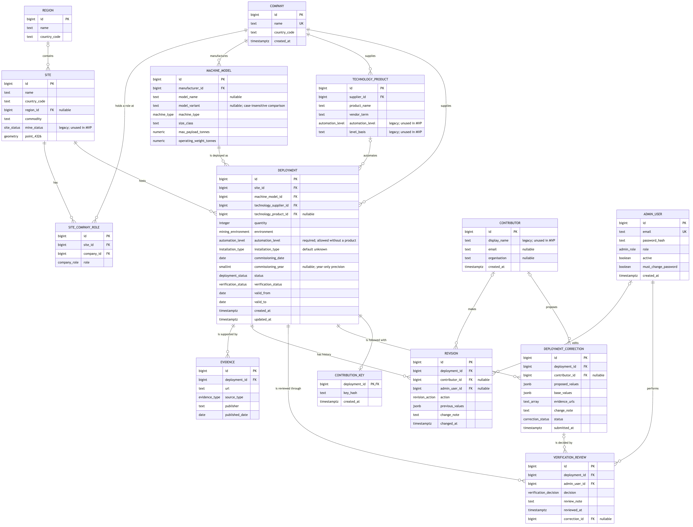

# Software Requirements Specification

## Autonomous Mining Equipment Market Map

| | |
|---|---|
| **Version** | 0.7 — draft for team review and client confirmation |
| **Date** | 15 October 2026 |
| **Client** | Dr Adrian Boeing, UWA |
| **Representative users** | RCT Global (Yash Singh, market data analytics) · Epiroc (Milan Ivovic, Regional Business Manager, Asia Pacific) |
| **Unit** | CITS5206 Capstone Project, Semester 2 2026 |
| **Prepared by** | Group 5 — Hengan Weng (24201874), Shee Wang (24368932), Zerun Zhang (24389925), Hans Lionar (24661999), Zunhao Zhang (24758673), Tyrone Tran (24814799) |

### Revision history

| Version | Date | Author | Change |
|-------|--------------|----------------|-----------------------------------------------------------------------------------|
| 0.1 | 10 Aug 2026 | Group 5 | Initial draft, from the client meeting of 6 August, the facilitator meeting of 7 August, and the written project brief |
| 0.2 | 11 Aug 2026 | Group 5 | Incorporates the client and representative user meeting of 11 August, and internal review. Issued to the client on 12 August 2026 |
| 0.3 | 25 Aug 2026 | Hans Lionar (M2) | Automation banding withdrawn: four levels are now recorded **and** presented, so the former FR-10 rollup is removed and the map, analytics and data-model requirements are renumbered. Region promoted from a text field to reference data. Satellite and aerial imagery recorded as out of scope, with Q-12. Vendor sources REF-4 and REF-5 added in support of the four-level scale. Historical dates raised from *Could* to *Must*, and the map time control from *Could* to *Must*, both being required by the capability offered in place of market forecasting |
| 0.4 | 26 Aug 2026 | Hans Lionar (M2) | Section 5 aligned to the submitted Deliverable 1 report and to `docs/database/ERD.md`, which the project plan makes normative for enumerations and constraints. The duplicate diagram in 5.1 is replaced by the maintained one, so the technology product is correctly optional on a deployment before verification (FR-08), and the administrator and verification review entities required by FR-43 and FR-45 are present. No requirement renumbered or reprioritised |
| 0.5 | 5 Oct 2026 | Hans Lionar (M2) | Client Meeting 3 (18 September) is incorporated as source CM3 and applied to the requirements it confirmed or changed, with the specification reconciled against what Sprint 3 built. The four-level automation model is confirmed and split between product classification (FR-09) and a deployment's own proposed level (FR-57); contribution and verification are reworded (FR-42 to FR-48); FR-51 and FR-55 are bounded; FR-56 is added; and NFR-03, NFR-11 and C-01 follow the protection implemented and the public-host MVP. Appendix A questions are closed or restated — Q-1a, Q-3 and Q-5 carry a proposed answer awaiting the client — and every item this revision changed is tagged *(rev 0.5)*. |
| 0.6 | 6 Oct 2026 | Hans Lionar (M2) | Issue #158 aligns the requirements that no longer matched CM3 or the delivered MVP, and the CM3 recording is adopted as the primary source and cited by timing: FR-03 becomes *Should*, supported by the data model with no interface this semester, the mine site's own operating status is recorded as out of scope in Section 7 rather than carried as a requirement, and the site coordinates FR-04 retains stay a *Must*; FR-46 states which fields a correction may change and that a record's site, manufacturer, model and machine type are instead fixed by rejecting and resubmitting, with a matching Section 7 entry; FR-16 follows the client's own "show decommissioned" option; and FR-19 follows the map's year-selecting time control, whose precision FR-11's rationale now matches. The recording settles the automation level, closing Q-1a, Q-5, Q-13 and Q-16: the four levels take the client dataset's labels with no order of display required, FR-57 carries the scale and makes the level a fact the contributor states and an administrator confirms by approving the record, FR-55 excludes the level from the evidence check, FR-07 and FR-08 take the field set the client closed, under which a technology product is never required, and FR-09 and FR-58 are withdrawn to Section 7, the client having rejected deriving the level from the product and the form's help text needing no requirement. Q-17 and Q-18 carry the FR-03 re-prioritisation and the site-status exclusion to the client, Q-19 and Q-20 record the duplicate rule (issue #168) and the evidence-link rule left over from Q-5, Q-21 asks what Operator Assistance covers, Q-22 asks whether a contributor may answer "Not sure" for the level, and every item this revision changed is tagged *(rev 0.6)*. |
| 0.7 | 15 Oct 2026 | Tyrone Tran (M1) | Issue #203 closes the submission review loop, so that every submission ends verified or rejected and each step has one party to act. FR-43 adds the verification status *changes requested*, kept apart from records loaded without review; FR-45 lets an administrator decide on a record with changes requested, shows the note on a rejection or a request for changes to the contributor, and closes a rejected record; FR-46 limits changes to a record that is not yet verified, apart from an administrator's correction, to its contributor while it is pending review or has changes requested, records that an administrator may correct a site's coordinates, and lets a contributor supply coordinates a site lacks. FR-59 to FR-61 are added: following one's own submissions without an account (*Must*), resubmitting a rejected submission as a linked record (*Should*) and a tracking link for another browser (*Could*). Sections 3.1, 5.2 and 7 and Appendix B.5 follow, and Q-23 asks the client to confirm the loop. Q-19 carries the duplicate rule built in #192 as a proposed answer. Every item this revision changed is tagged *(rev 0.7)*. |

### Requirement status convention

Every requirement carries a status. This distinguishes what the client has stated from what the team has inferred, and prevents assumptions being mistaken for agreement.

| Status | Meaning |
|---|---|
| ✅ **Confirmed** | Stated by the client. Source referenced, using the codes defined in Section 1.4. |
| ❓ **Assumed** | Inferred by the team. Carries no client source. Each is mapped to an open question in Appendix A. |
| — | **Not applicable.** A withdrawn requirement. The reason is recorded in Section 7 or in the source column. *(rev 0.6)* |

Priority uses MoSCoW: **M** must have · **S** should have · **C** could have · **W** won't have this semester.

---

# 1. Introduction

## 1.1 Purpose

This document specifies the requirements for the Autonomous Mining Equipment Market Map, a web application that catalogues autonomous and teleremote mining equipment deployed worldwide. It is intended for the project team, the client, and the unit facilitator, and serves as the reference against which the delivered system is assessed.

## 1.2 Scope

The system is a **web-based, crowdsourced, queryable geospatial database** of autonomous mining equipment. It comprises:

- a **map** presenting deployments geographically,
- an **analytics view** presenting market-level trends,
- a **queryable equipment register** with data export,
- a **contribution mechanism** allowing industry participants to submit and correct records, with a verification state attached to each record.

The system does not perform mine planning, fleet management, or any operational control function. It is a reference dataset and presentation layer.

**The problem it addresses.** Data on autonomous mining equipment is closed and commercially held. Market reports exist but cost in the order of $50,000–$100,000 per report, placing them beyond the reach of startups, small suppliers and academic researchers (CM1). No open dataset was found to exist (CM1). The product is intended as an open, crowdsourced equivalent of the commercial market dashboards, whose figures come from a single vendor and cannot be independently checked (CM2). The project's purpose is to create that dataset and return the information to the public domain.

The cost of the market being poorly observed is concrete. A supplier can learn of a competitor entering its home market only after roughly 1,500 machines have been deployed, and a change in the automation supplier behind a machine brand can go unnoticed for months (CM2). Currency and coverage therefore matter as much as accuracy.

## 1.3 Definitions and abbreviations

### Automation terminology

These terms are defined further in Section 2.6. *(rev 0.6)*

| Term | Definition |
|---|---|
| **Autonomous machine** | A machine intended to operate in autonomous mode during its normal operating cycle (ISO 17757:2019). |
| **Autonomous mode** | A mode in which the machine performs all safety-critical and mining functions related to its defined operations without operator interaction (ISO 17757:2019). |
| **Semi-autonomous machine** | A machine that operates autonomously during part of its cycle and requires active operator control to complete some tasks (ISO 17757:2019). |
| **Remote control** | Operator control of a machine from a device not located on the machine (ISO 17757:2019). |
| **Teleremote** | Industry term, not defined by ISO. Remote operation from a control station using camera and telemetry feeds, without line of sight. An operator is still driving the machine. |
| **Line of sight remote** | Remote operation where the operator can directly see the machine. |
| **ODD** | Operational design domain. The conditions under which an automated system is designed to function. |
| **Operator-to-machine ratio** | The number of machines a single operator controls. A commercial distinction between vendor product tiers; not recorded as a field. |

### Equipment and operations

| Term | Definition |
|---|---|
| **AHS** | Autonomous Haulage System. An automated haul truck fleet. |
| **Haul truck** | Large off-highway truck carrying ore or waste from the pit. |
| **LHD** | Load-Haul-Dump machine, also called a scoop tram. The common underground loader. |
| **Ultra class** | Haul truck size class, generally 290 t payload and above. |
| **Dozer** | Tracked or wheeled machine for pushing material. |
| **Excavator / shovel** | Machine that loads material into haul trucks. |
| **Drill rig** | Machine that drills blastholes for explosives, or drills underground development. |
| **Scaling machine** | Underground machine that removes loose rock from tunnel walls and roof. |
| **Shotcrete machine** | Underground machine that sprays concrete to support tunnel walls. |
| **Tramming** | Driving a machine between locations, as distinct from loading or dumping. |
| **Payload** | The mass a machine is rated to carry. |
| **Retrofit** | Fitting an automation system to a machine that was manufactured without it. |
| **Open pit / surface mining** | Mining from the surface. |
| **Underground mining** | Mining via shafts and tunnels. Considerably more varied in machine types than surface mining. |

### Commercial and organisational

| Term | Definition |
|---|---|
| **OEM** | Original equipment manufacturer. The company that built the machine, e.g. Caterpillar, Komatsu, Liebherr. |
| **Technology supplier** | The company supplying the automation system, frequently **not** the machine manufacturer. |
| **Mining contractor** | A company engaged to operate a site or its equipment on behalf of the owner. A substantial part of the market. |
| **Joint venture** | Shared ownership of a site by two or more companies. Common, and the reason site ownership is many-to-many. |
| **Tenement** | The legal title granting rights to mine an area. |
| **Commodity** | The material extracted — iron ore, coal, gold, copper, lithium. |
| **Commissioning** | The period during which a site or machine is brought into service before full operation. |
| **FMS** | Fleet management system. Dispatch and production software, e.g. Wenco, Modular Mining. Distinct from automation. |
| **CAGR** | Compound annual growth rate. |

### Project and document terms

| Term | Definition |
|---|---|
| **Site** | One mine, at one location.  The place a deployment sits.  Roy Hill, Mount Whaleback and Cape Lambert are three separate sites, all of them in the Pilbara region. |
| **Region** | The mining region a site sits in, below national level — for example the Pilbara, the Bowen Basin, Atacama. Not a commercial sales territory such as Asia Pacific; grouping above national level is by country. |
| **Machine type** | The category of machine — haul truck, dozer, excavator, loader, drill, LHD, scaler, shotcrete machine. |
| **Machine model** | A specific model from a manufacturer, for example Caterpillar 793F. A model implies its machine type. |
| **Deployment** | The central record of this system. A quantity of one machine model, at one site, fitted with automation technology from one supplier and, where named, one technology product, from a given date. *(rev 0.6)* |
| **Technology product** | A named automation system, e.g. Cat Command for Hauling, Sandvik AutoMine, RCT ControlMaster. |
| **Automation level** | One of four levels: Highly Autonomous, Semi Autonomous, Teleremote and Operator Assistance. Recorded on each deployment, where the contributor states it and an administrator confirms it by approving the record (FR-57). It is not derived from the technology product (Section 2.6, Section 7). *(rev 0.6)* |
| **Verification status** | Where a record stands in review: unverified, pending review, changes requested, verified or rejected. *(rev 0.7)* |
| **Site status** | Whether the mine itself is operating or under commissioning. Distinct from deployment status, and not required for the MVP (Section 7). *(rev 0.6)* |
| **Deployment status** | Whether a particular quantity of automated equipment at a site is announced, being commissioned, operational or decommissioned. |

## 1.4 References

| Ref | Document |
|---|---|
| BRIEF | Autonomous Mining Equipment Market Map — client project description — https://teaching.csse.uwa.edu.au/units/capstone/projects/submit-preference/8/ |
| CM1 | Client Meeting 1 minutes and transcript, 6 August 2026 |
| CM2 | Client and representative user meeting, 11 August 2026 — Dr Boeing, Yash Singh (RCT Global), Milan Ivovic (Epiroc), Group 5 and Group 15. Full transcript |
| CM3 | Client Meeting 3, 18 September 2026 — demonstration of the current build and requirements review. The recording and its bilingual transcript are the primary source, cited as *CM3 recording, hh:mm*; the recording is not held in the repository. The written minutes are at `docs/meeting_minutes/2026-09-18-client-meeting-3.md`, and a reference of the form CM3 §2 is to those minutes. *(rev 0.6)* |
| FM1 | Facilitator Meeting 1 minutes and transcript, 7 August 2026 |
| DATA-1 | Client dataset — anonymised `Machine_Data_Anonymized.csv`, supplied at CM3 on 18 September 2026. Column list and normalisation rules recorded in team issue #68 and in `docs/database/ERD.md`, *Normalisation rules* |
| REF-1 | AV Map — https://avmap.io/ (reference site nominated by client) |
| REF-2 | Brad Templeton, Autonomy Map — https://www.templetons.com/brad/robocars/autonomap.html (reference site nominated by client) |
| REF-3 | CSRankings — https://csrankings.org/ (crowdsourced submission model nominated by client) |
| REF-4 | RCT Global, AutoNav — five scalable levels of automation: line-of-sight control, tele-remote, semi-automation, multi-machine automation, fleet automation — https://rct-global.com/technology/automation-control/ |
| REF-5 | Sandvik Mining, AutoMine automation portfolio — Tele-Remote, Lite, Multi-Lite and Core for underground loading and hauling; Line of Sight, Control Room and Autonomous for surface drilling — https://www.mining.sandvik/en/digital-solutions/automation/ |
| STD-1 | ISO 17757:2019 — *Earth-moving machinery and mining: autonomous and semi-autonomous machine system safety*. Catalogue entry: https://www.iso.org/standard/76126.html · Terms and definitions, Online Browsing Platform: https://www.iso.org/obp/ui/en/#iso:std:iso:17757:ed-2:v1:en |
| STD-2 | Global Mining Guidelines Group, *Guideline for the Implementation of Autonomous Systems in Mining*, version 2, 2024. Section 2.1, Figure 1 *Mining Automation Maturity Model*, p. 7 — https://gmggroup.org/wp-content/uploads/2024/08/GUIDELINE_Implementation-of-Autonomous-Systems-1.pdf |
| STD-3 | SAE International J3016_201806, *Taxonomy and Definitions for Terms Related to Driving Automation Systems for On-Road Motor Vehicles*, 2018 — the taxonomy GMG adapted — https://www.sae.org/standards/content/j3016_201806/ |

## 1.5 Document overview

Section 2 describes the product context, users and constraints. Section 3 specifies external interfaces. Section 4 specifies functional requirements and Section 5 the logical data structure. Section 6 specifies non-functional requirements. Section 7 records what is deliberately out of scope. Section 8 records assumptions and dependencies.

Appendix A lists the open questions requiring client confirmation, with the hosting environment checklist. Appendix B is a checklist for recording the client's confirmation of scope.

Every requirement carries a source, recorded in the tables and using the codes defined in Section 1.4: the written project brief (BRIEF), the meeting records (CM1, CM2, CM3, FM1), the client dataset (DATA-1), the reference sites nominated by the client (REF-1 to REF-3), the vendor catalogues consulted (REF-4, REF-5), and the standards consulted (STD-1 to STD-3). A requirement with no such source is the team's own proposal and is marked ❓.

---

# 2. Overall description

## 2.1 Product perspective

The system is a new, self-contained web application with no dependency on existing systems and no predecessor. No comparable open dataset exists (CM1).

It draws design precedent from two reference sites nominated by the client (REF-1, REF-2), both of which map autonomous vehicle deployments on public roads, and from CSRankings (REF-3) for its crowdsourced submission model.

## 2.2 Product functions

The brief specifies four deliverables, and they are the system's four functions. The first three were described by the client in CM1, and the set of four was accepted in CM2.

| Function | Named in the brief as | Purpose |
|---|---|---|
| **Interactive GIS map** | *An interactive GIS Map layer demonstrating geographical asset distribution* | Orientation and browsing. A user unfamiliar with the domain explores the map and learns from it. |
| **Analytics dashboard** | *A Data Analytics Dashboard visualizing automation adoption trends* | Market-level measures only — counts and shares by supplier, manufacturer, country, machine type and automation level, and how they change over time. |
| **Queryable equipment register** | *A queryable database of global autonomous mining assets* | The record set itself, searchable and sortable, with export so users can analyse the data externally. |
| **Verified crowdsourcing** | *A verified crowdsourcing mechanism allowing industry professionals to submit new kit data* | Submission, correction and verification of records — the mechanism by which the dataset is built. |

These are presented as three top-level tabs, with the dashboard and the register as sub-views of a common data section. Section 3.1 describes the screens.

## 2.3 User characteristics

| User class | Description | Primary needs |
|---|---|---|
| **Academic / researcher** | Including the client. Studies market and technology trends. | Which automation products are being adopted, and how that is shifting. Raw data for independent analysis. |
| **Startup** | Evaluating whether a product idea has a market. | General market data: which segments and regions are saturated, which are open. |
| **Technology supplier — market analyst** | e.g. RCT Global. Supports product managers and sales managers with market data, reviewed quarterly and tracked monthly (CM2). | Market share held and lost; new entrants and consolidation among automation suppliers; where a segment is unautomated and therefore addressable. |
| **Technology supplier — regional sales** | e.g. Epiroc. Sells and implements automation across a region (CM2). | Which technology is deployed at sites comparable to a given customer's — same commodity, same mining method — in order to recommend an equivalent configuration. |
| **Contributor** | Industry participant adding or correcting records. Often site-level personnel. | Fast, low-friction submission. Frequently possesses accurate figures with no published source. |
| **Administrator** | Client or delegate. | Review and verification of submissions; correction of erroneous records; maintenance of reference data such as regions and machine models. *(rev 0.6)* |

Casual users with no specific goal are not treated as a separate class; their needs are met by the map without additional requirements.

Within a single supplier's sales and operations function, distributed across country offices, the expected readership is of the order of 100 people (CM2). This is an indication of scale, not a performance target.

## 2.4 Constraints

| ID | Constraint | Source |
|---|---|---|
| C-01 | The application must be deployable within a UWA IT environment as far as practical. The phrase is the brief's and admits several readings — see Q-4. **Superseded for the MVP by CM3:** the MVP may run locally or on a public host; a future handover may place it on UWA hosting (NFR-11). *(rev 0.5)* | BRIEF, CM3 |
| C-02 | Data is to be published openly under a Creative Commons licence. | BRIEF |
| C-03 | Technology stack is the team's choice, subject to C-01. | BRIEF |
| C-04 | Delivery is bounded by the Semester 2 2026 academic calendar and the team's available hours. | FM1 |
| C-05 | No seed dataset exists at project start. The client will supply generic data extracted from a market report, and has approached BHP, Rio Tinto and RCT; he expects perhaps two of three to provide data, and timing is uncertain. | CM1 |
| C-06 | Contributed data will vary widely in completeness. Corporate sources are expected to provide high-level data only. | CM1 |

## 2.5 Operating environment

Modern desktop web browser. No installation, no mobile application, no offline mode in this release.

## 2.6 Automation classification

**Why the dataset requires an automation attribute.** The brief does not list automation level among the fields to be collected, but two functions depend on it: determining what equipment is in scope, and filtering and grouping records in the map and analytics views. The client settled how it is captured: the contributor submits the level with the record, and an administrator confirms it by approving that record (CM3 recording, 14:54). Deriving the level from the technology product instead was put to the client and rejected, so no classification is held against a product in the MVP (Section 7). *(rev 0.6)*

> **Status: the four-level model and its labels are settled.** The client set three levels as the minimum the system must distinguish (CM2), and Client Meeting 3 agreed the four-level model, asking that the terminology stay consistent with both this specification and the vendor terms in the client dataset (CM3 §2). Those two sources disagree: revisions to 0.4 named the levels line-of-sight remote, teleremote, semi-autonomous and autonomous, while the client dataset names them, highest first, **Highly Autonomous, Semi Autonomous, Teleremote, Operator Assistance** (DATA-1). The client noted that his dataset names the levels differently and said it "doesn't really matter" (CM3 recording, 14:50); the team adopts the dataset's labels. They are the words contributors and administrators will meet in the data itself, and Q-1a is closed. *(rev 0.6)*

**The adopted vocabulary is the industry's own (Framework C below), not a standard.** Baseline, teleremote and autonomous are the words suppliers publish and contributors will recognise, and they are the words the client used. Two published frameworks are described first because they are what give those words a defensible definition: ISO 17757 supplies the terminology, and the GMG maturity model supplies the graduations. Neither is presented in the interface.

### Framework A — ISO 17757:2019

*Earth-moving machinery and mining: autonomous and semi-autonomous machine system safety* (STD-1). Terminology, oriented to safety. Terms and definitions are viewable without purchase on the ISO Online Browsing Platform: <https://www.iso.org/obp/ui/en/#iso:std:iso:17757:ed-2:v1:en>

| Term | Meaning |
|---|---|
| Autonomous machine | Operates in autonomous mode during its normal operating cycle |
| Semi-autonomous machine | Autonomous for part of the cycle; operator control required for some tasks |
| Remote control | Operator control from a device not on the machine |

"Teleremote" does not appear in the standard.

### Framework B — GMG *Implementation of Autonomous Systems*, v2 (2024)

The mining industry's own guideline, published by the Global Mining Guidelines Group (STD-2). Its maturity model is **adapted from the SAE International (2018) taxonomy of driving automation (STD-3) and expressed in ISO 17757 terminology** (STD-2, Section 2.1). Full text: <https://gmggroup.org/wp-content/uploads/2024/08/GUIDELINE_Implementation-of-Autonomous-Systems-1.pdf>

| Level | Name | Definition (abridged from the guideline) | Band |
|---|---|---|---|
| **0** | No automation or autonomy | Entirely manual. Operator completes all tasks. | Manual |
| **1** | Operator assistance | Some function-specific automated features. The operator completes most tasks and maintains control. | Semi-autonomous |
| **2** | Partial automation | The system controls multiple functions within a set of defined operations. The operator performs other tasks and is generally responsible for situation awareness. | Semi-autonomous |
| **3** | Full automation | The system completes continuous operations autonomously, including situation awareness in the designated autonomous area. It identifies when intervention is needed and enters a halted state. **The operator performs the fallback.** | Autonomous |
| **4** | Partial autonomy | As level 3, but **the system performs the fallback** within a limited ODD, halting only in higher-risk situations. The supervisor may request disengagement. | Autonomous |
| **5** | Full autonomy | The system fully controls the machine, performs the fallback, and covers the same use cases as an operator within the same ODD. | Autonomous |

Note the ordering: **"Full automation" (3) sits below "Partial autonomy" (4)**. The distinction is not capability but responsibility for the fallback — at level 3 the operator recovers a halted machine; at level 4 the system recovers itself.

The figure groups the levels into three bands: **Manual** (level 0), **Semi-autonomous** (levels 1–2), and **Autonomous** (levels 3–5). It also defines operation-level stages beneath them: **manual operation**, **hybrid operation** (a mixed fleet), and **highly autonomous operation**.

Source: STD-2, Section 2.1, Figure 1 *Mining Automation Maturity Model*, page 7. Definitions in the table above are abridged from that figure.

> ⚠️ **Caveat on applicability.** The guideline describes the model as reflecting "the overall operation's level of autonomy" while also stating that levels are "assigned to mining equipment". Its primary intent appears to be operational maturity rather than per-machine classification. Applying it per deployment, as proposed below, is a reasonable adaptation but should be confirmed. *(rev 0.6)*

### Framework C — vendor vocabulary · **adopted**

Suppliers do not sell a continuum. They sell a ladder of distinct, separately priced tiers, and publish it as such: RCT markets five scalable levels of AutoNav (REF-4), and Sandvik's AutoMine range is structured the same way (REF-5). These are the terms a contributor will recognise and the terms a published announcement will use.

| Level | Name | What the operator does | Operators per machine | RCT AutoNav (REF-4) | Sandvik AutoMine (REF-5) | ISO 17757 | GMG |
|---|---|---|---|---|---|---|---|
| **1** | Line-of-sight remote | Drives by radio, watching the machine directly | 1 : 1 | Line-of-sight control | AutoMine Line of Sight | Remote control | 0 |
| **2** | Teleremote | Drives from a remote station on cameras and telemetry, without line of sight | 1 : 1 | Tele-remote | AutoMine Tele-Remote · Control Room | Remote control | 0–1 |
| **3** | Semi-autonomous | The machine performs the repetitive part of the cycle — typically tramming — while the operator performs the skilled part remotely | 1 : 1 or 1 : few | Semi-automation | AutoMine Lite | Semi-autonomous machine | 1–2 |
| **4** | Autonomous | The machine completes the operating cycle unattended within a designated area; one supervisor oversees several machines or a fleet | 1 : many | Multi-machine automation · Fleet automation | AutoMine Multi-Lite · Core · Autonomous | Autonomous machine | 3–5 |

The adopted labels name these same four tiers: Highly Autonomous is tier 4, Semi Autonomous tier 3 and Teleremote tier 2. Operator Assistance as tier 1 is the team's reading: the client spoke of "radio remote" (CM3 recording, 14:50) and of "guidance" (14:54), and GMG uses "Operator assistance" for its level 1, function-specific automated features with the operator in control (Framework B) — see Q-21. The names in the table above are the descriptive ones; the adopted labels are what the interface shows (FR-57). *(rev 0.6)* The scale is ISO 17757's three terms, with **remote control split into the two tiers vendors sell separately**. The operator-to-machine ratio is what changes commercially across the four, and it is why they are priced as distinct products.

**Why four rather than five.** RCT publishes five levels, separating multi-machine automation from fleet automation; Sandvik makes the same separation between Multi-Lite and Core. The distinction between them is the size of the fleet under one supervisor, not what the operator does — in both cases the machine completes its cycle unattended. Levels 4 and 5 are therefore recorded as a single autonomous level. The four boundaries that remain each mark a change in the operator's role, which is what makes them observable from a published source.

Note that remote operation, however sophisticated the control room, does not by itself make a machine autonomous: at levels 1 and 2 the operator is still driving. This is where the vendor vocabulary and the standards diverge most sharply, and it is the distinction the dataset exists to record.

### Proposal

**0. Four levels are recorded and presented.** Three levels were set as a minimum rather than a limit (CM2). The team proposes recording the four vendor tiers of Framework C, for three reasons.

*Suppliers publish four or more tiers, not three.* RCT markets AutoNav as five scalable levels — line-of-sight control, tele-remote, semi-automation, multi-machine automation and fleet automation (REF-4). Sandvik's AutoMine range is structured the same way, with Tele-Remote, Lite, Multi-Lite and Core for underground loading and hauling, and Line of Sight, Control Room and Autonomous for surface drilling (REF-5). Two independent suppliers therefore price semi-automation as a product distinct from both teleremote and full autonomy. A three-level scale cannot represent that market; a four-level scale can, and maps onto both vendors' ladders without loss.

*The primary use case needs the fourth.* Both representative users described the same analysis: identify sites operating at a lower tier and approach them about the next one (CM2). That analysis is a query over the level — find the machines at line-of-sight or teleremote in a given country, and target them for semi-autonomy. Merging those tiers makes the query unanswerable from the wrong side of the distinction that generates the sale.

*Aggregation is one-way.* A finer scale can always be grouped into a coarser one; a coarser scale cannot be split afterwards without revisiting every record and every classification decision. The fourth level costs one enumerated value now and cannot be recovered later.

Four levels satisfy the client's requirement of at least three, and distinguish the tiers the suppliers themselves sell. ISO 17757 and the GMG levels are not shown to a user. The four-level model was confirmed in CM3, and the labels follow the client dataset, the client having said the naming does not matter (see the status note above). *(rev 0.6)*

**1. The technology supplier and the automation level are both submitted facts.** The supplier is the system's principal subject — which automation technology is fitted to a machine, and which company supplied it (CM1) — and it is what a contributor knows and what a published source states. The level is submitted alongside it rather than derived from it: the client was asked whether it could be taken from the technology product and said it should come from the contributor (CM3 recording, 14:54), so the level is recorded on the deployment and an administrator confirms it by approving the record (FR-57). *(rev 0.6)*

**2. Products are not classified.** The full population of automation products cannot be enumerated in advance — a realistic estimate is fifty or more, once vendor tiers and underground categories are counted. A product is therefore created when a contributor first names it, and is not classified at an automation level: the client asked for the level to be stated per deployment and rejected deriving it from the product, so product classification is out of scope (Section 7). *(rev 0.6)*

**3. The level is an attribute of the deployment, not of the product.** A deployment carries its own level, stated with the record and confirmed on approval, and that is the level presented, filtered and aggregated everywhere. Specified in FR-57 and modelled in Section 5. *(rev 0.6)*

**4. Scope is limited to equipment with automation technology fitted.** Entirely manual equipment is excluded, since it comprises effectively the whole global fleet and is neither collectable nor within the product's purpose. Teleremote equipment is in scope, being one of the four levels (CM2). The technology product need not be named for a record to be accepted or verified; the supplier and the level are what verification requires. Specified in FR-08. *(rev 0.6)*

**5. The level is stated on every submission.** Public sources frequently report that a machine is automated without stating to what degree, and a representative user identified this as the normal case rather than the exception (CM2). The client nevertheless asked for the level to come from the contributor (CM3 recording, 14:54), so it is part of the minimum field set (FR-07) and a record is not verified until it carries one (FR-08), confirmed by an administrator on approval (FR-57). Where a contributor is unsure, the four levels are described on the form so the choice can be made, and an administrator may correct it at review (FR-46). *(rev 0.6)*

---

# 3. External interface requirements

## 3.1 User interfaces

Four primary screens. Static mockups exist for each (see `docs/ui/`), and are indicative of structure rather than final visual design.

| Screen | Contents |
|---|---|
| **Map** | Geospatial view with filter panel, markers coloured by deployment status, and a detail panel listing the selected site's deployments — machine model or type, quantity, technology supplier and status — with a link through to the full record. |
| **Data → Analytics** | Headline statistics strip, market trend charts. |
| **Data → Equipment** | Filterable record table with export and per-record edit. |
| **Contribute** | Submission form, and the contributor's own submissions with their status and any request for changes (FR-59). *(rev 0.7)* |

Navigation is three top-level tabs — Map, Data, Contribute — with Analytics and Equipment as sub-views of Data.

## 3.2 Hardware interfaces

None. The system does not interface with machinery, sensors or on-site equipment.

## 3.3 Software interfaces

| Interface | Purpose | Status |
|---|---|---|
| Identity provider (Microsoft, Google) via OpenID Connect | Optional contributor sign-in and email domain confirmation | ❓ Proposed |
| Geocoding service | Resolving new mine site locations to coordinates | ❓ Proposed |
| Web search service | Locating public evidence for a submitted claim (FR-55) | ❓ Proposed |
| Language-model service | Assessing retrieved evidence and producing the verification report (FR-55) | ❓ Proposed |

No commercial map tile service is required. The base map is drawn from a static public-domain vector dataset of coastlines and borders, which is sufficient at the zoom levels this system uses — the map answers where deployments are, not what a site looks like.

**Satellite and aerial imagery are excluded from this release** and proposed as a later extension. See Section 7 for the reasons.

## 3.4 Communications interfaces

All traffic between browser and server uses HTTPS. Requests to external services — map tiles, identity providers, and any search or language-model service — likewise use HTTPS. No other network protocol is required.

---

# 4. Functional requirements

## 4.1 Data model

| ID | Requirement | Priority | Status | Source |
|---|---|:--:|:--:|---|
| FR-01 | The system shall record equipment deployments linked to a mine site, each recording machine model, manufacturer, machine type and quantity, and the automation technology fitted: one technology supplier and, where named, one technology product. *(rev 0.6)* | M | ✅ | CM1, BRIEF |
| FR-02 | The system shall record the base machine manufacturer and the technology supplier as separate, independently queryable values. | M | ✅ | CM1, BRIEF |
| FR-03 | The system shall record any number of companies against a mine site, each with a stated role of owner, operator or contractor. The MVP supports this in the data model only: no interface presents, filters by or captures a site's companies and roles. *(rev 0.6)* | S | ✅ | CM1. CM3 §2 does not list site companies among the important attributes, CM3 §3 ranks a company filter as "also useful", and the client placed it "at the end, if you feel like it" (CM3 recording, 14:22) — priority proposed, see Q-17 |
| FR-04 | The system shall record mine sites with name, coordinates and commodity. The mine's own operating status is not required for the MVP (Section 7). Associated companies are recorded per FR-03. *(rev 0.6)* | M | ✅ | CM1. CM3 §1 confirms a town name geocoded to a map location, and CM3 §2 lists site or region and geographic location among the important attributes |
| FR-05 | The system shall record the commissioning date of each deployment, and its status as one of announced, commissioning, operational or decommissioned. | M | ✅ | CM1, BRIEF |
| FR-06 | The system shall support surface and underground machine types, including haul trucks, LHDs, dozers, drills, scalers and shotcrete machines. | M | ✅ | CM1 |
| FR-07 | The system shall accept a record where the minimum field set is present, with all other fields optional. The minimum set is the mine site, machine manufacturer, machine type, machine model, quantity, technology supplier and automation level; the machine model variant is optional, and the technology product is not required at any stage. The site's country and the disclosure acknowledgement (FR-41) are also required. *(rev 0.6)* | M | ✅ | CM1, C-06; CM3 recording, 14:53 settles the field set — the country and the disclosure tick are team additions |
| FR-08 | The system shall accept records only for equipment with automation technology fitted. A record shall not be verified unless it names a technology supplier and carries an automation level; the technology product need not be named at any stage. *(rev 0.6)* | M | ✅ | CM1 and CM2 for the scope rule, Q-1 having settled that teleremote equipment is in scope; CM3 recording, 14:53 for the verification prerequisites |
| FR-09 | **Withdrawn.** Classification of each technology product's automation level is not required; the level is stated per deployment under FR-57. Recorded in Section 7. *(rev 0.6)* | W | — | CM3 recording, 14:54 — the client asked for the level to be stated per deployment and rejected deriving it from the product |
| FR-10 | The system shall record whether a deployment operates on the surface, underground, or both. | M | ✅ | CM2 |
| FR-11 | The system shall record valid-from and valid-to dates on each deployment, so that the state of the dataset at the end of a past year can be reconstructed, that being the precision the map's time control works at (FR-19). *(rev 0.6)* | M | ❓ | Required by FR-19 |
| FR-12 | The system shall support geographic grouping of deployments by mine site, region and country, region being selected from a maintained list rather than entered as text. Association of sites with companies is by role, per FR-03. | S | ✅ | CM1, BRIEF |
| FR-13 | The system shall record machine size class, maximum payload and operating weight. | S | ✅ | CM1, BRIEF |
| FR-14 | The system shall mark equipment as decommissioned rather than deleting it, and create a new record where equipment relocates. | S | ✅ | CM1 |
| FR-56 | The system shall record whether a deployment's automation technology was factory-installed or retrofitted, as an optional attribute defaulting to unknown, since it will not always be known. *(rev 0.5)* | S | ✅ | CM3 |
| FR-57 | Each deployment shall carry an automation level, one of Highly Autonomous, Semi Autonomous, Teleremote or Operator Assistance, shown in the interface by these labels. The contributor states the level when submitting the record; an administrator confirms it by approving the record and may correct it (FR-46). No automated check applies to the level (FR-55). *(rev 0.6)* | M | ✅ | CM3 §2 lists automation level among the information the client identified as important; CM3 recording, 14:50 confirms the four levels and says their naming does not matter, and 14:54 confirms that the contributor submits the level |

*Note: FR-56 to FR-58 are numbered after the last existing requirement so that no requirement is renumbered. FR-56 and FR-57 belong with the data model above; FR-58 sits with contribution and verification in Section 4.5.*

\newpage

## 4.2 Map

| ID | Requirement | Priority | Status | Source |
|---|---|:--:|:--:|---|
| FR-15 | The system shall display a map with one marker per mine site at its geographic location. | M | ✅ | CM1 |
| FR-16 | The map shall default to operational deployments, with decommissioned deployments shown through a "show decommissioned" checkbox. Commissioning and announced deployments are recorded (FR-05) but need not be shown on the map. Marker colour shall not be the sole encoding of status; status shall remain available as readable text in the site detail. *(rev 0.6)* | M | ✅ | CM3 recording, 14:24 for the default and the checkbox and 14:23 for commissioning and announced remaining in the data model, superseding CM1; REF-2 |
| FR-17 | Selecting a marker shall display the site and, for each deployment recorded against it, the machine model or, where no model is recorded, the machine type; together with quantity, technology supplier and status. Further detail is served by the equipment register. | M | ✅ | CM1 |
| FR-18 | The map shall be filterable by technology supplier. | M | ✅ | CM1 |
| FR-19 | The map shall provide a time control that selects a year and restricts the markers shown to the deployments in service at the end of that year, so that accumulation over time can be observed. A year is the unit because the client dataset records commissioning at year precision, and no month or day is invented from it. Deployments with no commissioning year are excluded, and the number excluded shall be stated. The rule shall be the one the analytics timeline uses, so that the machine counts on the map reconcile with that year's in-service figure (FR-22). *(rev 0.6)* | M | ✅ | CM1, CM2, REF-1; the year unit follows the client dataset supplied at CM3 §1 — DATA-1 |
| FR-20 | The map shall be filterable by country, region, machine type, automation level, commodity, and surface or underground operation. | S | ✅ | CM2 |

## 4.3 Analytics

All measures below are computed over recorded deployments — that is, over automated equipment held in this dataset. They are not proportions of the total mining fleet, which the system does not record. Every measure is subject to the filters in FR-36.

| ID | Requirement | Priority | Status | Source |
|---|---|:--:|:--:|---|
| FR-21 | The system shall display headline statistics: total automated machines recorded, total sites, and countries covered. | M | ✅ | CM1 |
| FR-22 | The system shall display the cumulative count of machines in service over time. | M | ✅ | CM2 |
| FR-23 | The system shall display the count of machines by country. | M | ✅ | CM2 |
| FR-24 | The system shall display the count of machines by machine type. | M | ✅ | CM2 |
| FR-25 | The system shall display the share of machines held by each technology supplier. | M | ✅ | CM1, CM2 |
| FR-26 | The system shall display the share of machines held by each machine manufacturer. | M | ✅ | CM2 |
| FR-27 | The analytics view shall provide filters for country, region, machine type, manufacturer, technology supplier, automation level, commodity, and surface or underground operation, applying to every measure displayed. | M | ✅ | CM2 |
| FR-28 | The analytics view shall report only the aggregate measures specified in this section. Analysis of individual records is served by the register and by data export. | M | ✅ | CM1 |
| FR-29 | The system shall display the share of machines at each automation level, and the same breakdown for a selected country. | S | ✅ | CM2 |
| FR-30 | The system shall display the number of machines newly commissioned in each year. | S | ✅ | CM2 |
| FR-31 | Selecting a machine type shall show the manufacturers and technology suppliers active in that type, ranked by machine count. | S | ✅ | CM2 |
| FR-32 | Within a selected machine type, the system shall break down machine counts by payload class. | S | ✅ | CM2 |
| FR-33 | The system shall display the count of machines by company role, each role aggregated separately. | S | ✅ | CM1 |
| FR-34 | The system shall display, for each country, the compound annual growth rate of the cumulative number of machines in service. Countries whose count is zero at the start of the period are reported as an absolute increase, the rate being undefined from a zero base. | C | ✅ | CM1 |
| FR-35 | The analytics view shall allow a user to choose which measures are displayed and retain that arrangement between sessions. | C | ✅ | CM2 — see Q-11 |

## 4.4 Equipment register and export

| ID | Requirement | Priority | Status | Source |
|---|---|:--:|:--:|---|
| FR-36 | The system shall provide a searchable, filterable and sortable register of equipment records. | M | ✅ | BRIEF |
| FR-37 | The system shall export the dataset in a flattened tabular format suitable for external analysis. | M | ✅ | CM1, CM2 |
| FR-38 | Selecting a machine model shall display its recorded attributes — manufacturer, machine type, size class, payload and operating weight — together with the deployments recorded against it. | S | ❓ | Team proposal |
| FR-39 | Where a manufacturer's product page for a machine model is known, the model view shall link to it. | C | ❓ | Team proposal |

## 4.5 Contribution and verification

A submission is reviewed and decided as **one evidence-backed unit**: the administrator verifies or rejects the record as a whole rather than assigning independent truth values to each field, and the administrator makes the final decision (CM3). *(rev 0.5)*

| ID | Requirement | Priority | Status | Source |
|---|---|:--:|:--:|---|
| FR-40 | The system shall allow users to submit new equipment records via a web form. A contributor is not required to hold an account; an email address may be offered so an administrator can follow up (NFR-09). *(rev 0.5)* | M | ✅ | CM1, BRIEF, CM3 |
| FR-41 | The submission form shall state that a contributor must submit only information they are authorised to disclose. | M | ❓ | Team proposal — see A-04 |
| FR-42 | Submissions shall be accepted into the review queue immediately; a record becomes public once verified. *(rev 0.5)* | M | ❓ | Team reading of CM3's controlled submission path, superseding CM1's immediate publication — **to be confirmed with the client**, see Q-14 |
| FR-43 | Each record shall carry a verification status of unverified, pending review, changes requested, verified or rejected. A submission starts pending review; unverified marks records loaded without review. The public Map, Equipment Register and Analytics shall default to verified records only. Any presentation of unverified data shall be clearly labelled; the MVP provides no such option (Section 7). *(rev 0.7)* | M | ❓ | CM1 and CM3 confirm verification and verified-only display; the changes requested status is a team addition — see Q-23 |
| FR-44 | The system shall allow contributors to attach one or more evidence links to a record. Evidence is public URLs in the MVP, and a record shall not be verified without at least one evidence link. *(rev 0.6)* | M | ❓ | CM1, BRIEF and CM3 confirm evidence links as public URLs; requiring one before verification is a team rule — see Q-20 |
| FR-45 | The system shall provide an administration interface for reviewing submissions and recording a decision: verify, reject, or request changes. A decision may be recorded on a record that is pending review or has changes requested. Rejecting or requesting changes requires a note, which is shown to the contributor (FR-59). Each decision is kept as an append-only review record, and the record's verification status changes in the same transaction as the decision. A rejected record is closed and is not corrected. Administrators can list records by verification status and reject a record whose requested changes do not arrive. *(rev 0.7)* | M | ❓ | CM1 and CM3 confirm the review and its three decisions; deciding on a record with changes requested, showing the note to the contributor and closing a rejected record are team rules — see Q-23 |
| FR-46 | The system shall allow existing records to be corrected: contributors propose changes, and administrators correct records directly. A correction may change the deployment's own attributes — quantity, surface or underground environment, deployment status, automation level, installation type, and commissioning date or year — and may add evidence links; an administrator may additionally change the technology supplier and, where named, the product, and a site's coordinates, a change that applies to every deployment at that site. A record shall not be moved to a different site, machine manufacturer, machine model or machine type: an administrator rejects the record, and the contributor submits it again (FR-60, Section 7). Before a record is verified, apart from an administrator's correction, only its contributor may change it, with the submission's key (FR-59), and only while it is pending review or has changes requested; the change leaves it pending review. A contributor may also supply the coordinates of a site that has none, which approval needs (FR-04), but not move a site that has them. An administrator's correction shall not change the record's verification status, and every correction retains the revision history (FR-47). *(rev 0.7)* | M | ❓ | CM1 and CM3 §4 confirm correction with history retained, and CM3 §4 asks for the exact correction workflow to be made explicit; the correctable and fixed fields follow the implemented endpoints, and who may correct is a team decision — see Q-3 and Q-23 |
| FR-47 | The system shall retain the prior values of every change in the record's revision history, attributable to whoever made it. A revert action is a later candidate (team issue #114, option 3), not an MVP requirement. *(rev 0.5)* | S | ❓ | Team safeguard, CM3 (history retention) |
| FR-48 | Changes to a verified record shall be published only after administrator review; the record remains publicly visible, unchanged, while a correction is pending. *(rev 0.5)* | S | ❓ | Team decision, issue #114 — see Q-3 |
| FR-49 | The system shall allow supporting media — case studies, articles, videos — to be linked to companies, sites or equipment. | S | ✅ | CM1, BRIEF |
| FR-50 | The system shall provide a contact route for bulk data contributions, processed as a manual import. | S | ✅ | CM1 |
| FR-51 | The submission form shall include an automated-submission challenge to prevent bulk spam, without requiring the contributor to hold an account. Minimal acceptable form: a hidden honeypot field. Scheduled for Sprint 4. *(rev 0.5)* | S | ❓ | Team proposal — addresses spam risk while preserving anonymous contribution |
| FR-52 | The system shall support optional user accounts, including sign-in with an existing Microsoft or Google account. | C | ❓ | Team proposal implementing the client's trusted-account concept |
| FR-53 | Records contributed from a confirmed company email domain shall be flagged as affiliated and prioritised for review. | C | ❓ | Team proposal |
| FR-54 | The system shall record dated market events — a change of technology supplier behind a machine brand, an acquisition, or the release of a new automation product — linked to the companies and products they concern, and present them as a reverse-chronological feed. *(rev 0.6)* | C | ✅ | CM2; CM3 recording, 14:56 confirms it as a bonus rather than a requirement |
| FR-55 | An automated agent shall check a submission against public sources and produce a report assessing each claim — site identity, company roles, technology supplier and machine quantity — as supported, partially supported, contradicted or insufficient evidence, with the source relied on for each and an overall recommendation. The automation level is outside the scope of the check: it is submitted by the contributor and confirmed by an administrator (FR-57), and no automated assessment is applied to it. The agent shall not alter a record's verification status; the decision remains with a human reviewer. The agent is optional and administrator-triggered, and is non-blocking for the core MVP: a possible MVP 2 feature that must not displace the manual review workflow. *(rev 0.6)* | C | ✅ | CM1, CM3 |
| FR-58 | **Withdrawn.** The four levels the form offers are specified by FR-57; how each is explained to a contributor is interface help text and needs no requirement. *(rev 0.6)* | W | — | Team decision; FR-57 carries the level |
| FR-59 | The system shall let contributors follow their submissions without an account. Each submission receives a private key, kept in the contributor's browser. The Contribute page lists the submissions kept there, with each one's verification status and the administrator's note, refreshed when the site is opened, and lets the contributor update a submission that is pending review or has changes requested. Without the key, a record that is not verified cannot be viewed or changed. *(rev 0.7)* | M | ❓ | Team decision, issue #203 — closes the review loop that CM3 §4 asks to be made explicit; see Q-23 |
| FR-60 | A contributor shall be able to resubmit a rejected submission as a new record, prefilled from the rejected one. The two records are linked in their history, and the reviewer sees the earlier decision and its reason. *(rev 0.7)* | S | ❓ | Team decision, issue #203 — see Q-23 |
| FR-61 | The submission confirmation shall offer a private tracking link that adds the submission to the list in another browser. *(rev 0.7)* | C | ❓ | Team decision, issue #203 — see Q-23 |

---

# 5. Logical data structure

Entities are grouped into reference data, described once and reused, and the facts that reference them. Relationships between companies and sites are many-to-many rather than hierarchical (CM1).

## 5.1 Entity relationship diagram

The diagram shows the schema as built, including migration 005 (issue #171): a deployment names its technology supplier directly, the technology product is optional, and the level held against a product is no longer used. *(rev 0.6)*

The diagram is maintained as Mermaid source in `docs/database/ERD.md`, which the project plan makes normative for enumerations and constraints. The image above is generated from it. Types shown are those of the chosen PostgreSQL and PostGIS implementation; if PostGIS is unavailable, `point_4326` is held as latitude and longitude columns, which serve the point rendering and bounding-box queries the map requires.

\newpage

## 5.2 Entities

### Reference data

| Entity | Purpose |
|-----------------|-------------------------------------------------------------------------------------------------------|
| **Company** | A single table for every organisation — machine manufacturers, technology suppliers, mine owners, operators and contractors. What differs between them is the *role* they hold in a given context, not what they are. |
| **Region** | A named mining region below national level, described once and reused — the Pilbara, the Bowen Basin, Atacama. Held as reference data rather than as text on the site, so that filtering and grouping by region work at all: free text produces several spellings of one region and a filter list nobody can use. A site's country is recorded on the site, since a site may sit in no named region; where a region is given as well, its country and the site's must agree. |
| **Machine model** | A model of machine, described once and reused. For example *Caterpillar 793F*: manufacturer, model, machine type, size class, payload. A new submission must name the model (FR-07). The model name stays nullable in the database, so a record loaded from an existing dataset that gives only the manufacturer and machine type can still be held; it is shown by machine type (FR-17). *(rev 0.6)* |
| **Technology product** | An automation system, described once and reused. For example *Cat Command for Hauling*, *Sandvik AutoMine*, *RCT ControlMaster*. Carries the vendor term as published. The schema also has a level and basis against a product, but these are not maintained in the MVP: the automation level belongs to the deployment (Section 7). The four levels are stored as `autonomous`, `semi_autonomous`, `teleremote` and `operator_assistance`. *(rev 0.6)* |

### Facts

| Entity | Purpose |
|---------------------------|---------------------------------------------------------------------------------------------|
| **Deployment** | The central record. A quantity of one machine model, at one site, fitted with automation technology from one supplier and, where named, one technology product, from a given date. Carries the optional factory-installed/retrofit attribute (FR-56) and its own automation level, stated by the contributor and confirmed when an administrator approves the record (FR-57). This is what a contributor submits, what a row of the equipment register displays, and what appears in the detail panel of its site marker. *(rev 0.6)* A submission also holds a hash of its private key, which lets its contributor follow and update it (FR-59), and a resubmission links to the rejected record it replaces (FR-60). *(rev 0.7)* |
| **Site–company role** | Associates a company with a site in a stated role. A site typically has several: an owner, an operating subsidiary, and often a mining contractor. |
| **Evidence** | A source supporting a deployment record. |
| **Revision** | The history of a record — who changed it, when, and its previous values. A revision may be made by a contributor or by an administrator, so every change is attributable to whoever made it. |
| **Contributor** | An optional account, holding only an email address and, where offered, an organisation (NFR-09). Not required in order to submit. Domain affiliation is not recorded in the MVP; it arrives only if FR-52 and FR-53 are taken up. |
| **Administrator** | An account authorised to review submissions, verify or reject them, correct records, and maintain reference data such as regions and machine models. *(rev 0.6)* Authenticated by session cookie; no external identity provider is required (FR-45). |
| **Verification review** | One decision on one deployment: who decided, what was decided and why. Append-only, so a record's review history is retained rather than overwritten, and the deployment's current verification status is updated in the same transaction (FR-43, FR-45). The note on a rejection or a request for changes is shown to the contributor (FR-45). *(rev 0.7)* |

\newpage

## 5.3 Worked example

One deployment record, in full: *(rev 0.6)*

| Field | Value |
|----------------------------|--------------------------------------------------------------------------------------------|
| Site | Roy Hill |
| Machine model | Caterpillar 793F |
| Technology supplier | Caterpillar |
| Technology product | Cat Command for Hauling |
| Automation level | Highly Autonomous |
| Quantity | 96 |
| Commissioned | 2021 |
| Status | Operational |

The site record carries three company roles — Hancock Prospecting as owner, Roy Hill Holdings as operator, and any contractor engaged. Caterpillar is referenced twice from the one company record, once as manufacturer of the 793F and once as supplier of Cat Command for Hauling.

\newpage
## 5.4 Consequences of this structure

| Requirement | How the structure satisfies it |
|---------------------------------|---------------------------------------------------------------------------------------|
| Headline counts (FR-21) | `Σ deployment.quantity` over the filtered set, with distinct counts of site and country |
| Market share by supplier and by manufacturer (FR-25, FR-26) | Aggregate deployment quantity to the technology supplier, and through machine model to the manufacturer, as a share of the filtered total. How a supplier is held for a deployment with no named product is being decided in the new submission-fields issue *(rev 0.6)* |
| Share by automation level (FR-29, FR-57) | Aggregate on the deployment's own level, which every record carries from submission. No level is derived from the technology product, so no record is distributed across the levels on an assumption *(rev 0.6)* |
| Payload breakdown within a machine type (FR-32) | Machine model carries payload and size class; deployments inherit them |
| Market events feed (FR-54) | Not supported by this structure. Requires a dated event entity linked to companies and technology products |
| Count by company role (FR-33) | Aggregate deployments through site–company role, one role at a time. Where a site has several companies in the same role, as in a joint venture, the deployment counts once against each; the measure is therefore machines at sites in which the company holds that role, not an apportioned share |
| Machine manufacturer separate from technology supplier (FR-02) | Two distinct paths from deployment to company |
| Grouping and filtering by region (FR-12, FR-20) | Region is a reference entity, so every site in a region resolves to one value and the filter list is finite |
| Several companies per site (FR-03) | Site–company role permits any number, each typed. Ownership shares are not held; see Section 7 |
| Equipment relocation (FR-14) | Close the existing deployment with a valid-to date; create a new one |
| Historical view (FR-11, FR-19) | Filter deployments by valid-from and valid-to |
| Varying data completeness (FR-07, FR-08) | Technology product is optional at every stage; evidence is optional on a deployment until it is verified *(rev 0.6)* |
| Verified records shown by default (FR-43) | Deployment carries the current verification status; public views filter on it |
| Administrative review (FR-45) | Verification review records each decision against one deployment and one administrator, append-only, so the review history of a record is auditable |
| Correction of records (FR-46) | Revision links to either a contributor or an administrator, so every change is attributable to whoever made it |
| Automated evidence check (FR-55) | Not supported by this structure. Would require further entities for the verification report, its individual claim assessments and the reviewer's decision, added only if FR-55 is taken up |

---

# 6. Non-functional requirements

## 6.1 Accessibility and compatibility

| ID | Requirement | Priority | Status | Source |
|---|---|:--:|:--:|---|
| NFR-01 | The user interface shall meet the WCAG 2.1 Level AA success criteria for contrast, use of colour, keyboard operation, visible focus and form labelling. Conformance shall be recorded in an accessibility checklist stating how each was tested. | M | ❓ | Team standard |
| NFR-02 | The application shall function correctly in current versions of Chrome and Edge on desktop. | S | ❓ | Team standard |

## 6.2 Security

| ID | Requirement | Priority | Status | Source |
|---|---|:--:|:--:|---|
| NFR-03 | State-changing administrator requests shall be rejected unless they carry anti-forgery protection binding them to the administration session — origin-bound cookie attributes together with a required custom request header, or equivalent. Public submission is anonymous and carries no session; it will be protected by FR-51. *(rev 0.5)* | M | ❓ | Team standard |
| NFR-04 | Contributed text shall be escaped on output so that submitted content cannot execute as code in another user's browser. | M | ❓ | Team standard |
| NFR-05 | Database queries shall be parameterised. User input shall not be concatenated into a query. | M | ❓ | Team standard |
| NFR-06 | Administration functions shall require authentication. An unauthenticated or unauthorised user shall not be able to view administration data or perform administration actions. | M | ❓ | Team standard, FR-45 |
| NFR-07 | Credentials and service keys shall be supplied by environment configuration and shall not appear in the source repository. | M | ❓ | Team standard |

## 6.3 Data and privacy

| ID | Requirement | Priority | Status | Source |
|---|---|:--:|:--:|---|
| NFR-08 | The dataset published by the system shall be licensed under Creative Commons, the specific licence to be confirmed. Team proposal: CC BY 4.0. Third-party evidence and media linked from records retain their original copyright and licence. | M | ✅ | BRIEF, C-02 — see Q-10 |
| NFR-09 | The system shall collect from a contributor only an email address and, where offered, an organisation. The submission form shall state what these are used for. | M | ❓ | Team standard |
| NFR-10 | The application source code shall be published under an open-source licence, to be agreed with the client. Team proposal: MIT. | M | ❓ | BRIEF states "IP: Creative Commons (open source)" — see Q-10 |

\newpage

## 6.4 Deployment

| ID | Requirement | Priority | Status | Source |
|---|---|:--:|:--:|---|
| NFR-11 | The MVP shall run locally or on a public host; deployment into a UWA environment is a handover objective rather than an MVP requirement. The application shall avoid dependencies that would prevent later UWA hosting. *(rev 0.5)* | M | ✅ | CM3 supersedes the earlier reading of BRIEF/C-01 — handover environment still unconfirmed, see Q-4 in Appendix A |
| NFR-12 | The repository shall include setup instructions sufficient for a person outside the team to install and run the application on a Linux host. Any required third-party service, key, usage limit or recurring cost shall be documented. The application shall not depend on a paid service that has not been agreed as a project dependency. | S | ❓ | Team standard |

---

# 7. Out of scope

Recorded explicitly so that scope boundaries are traceable.

| Item | Reason |
|---|---|
| Unverified-data display option | Suggested by the client as an option (CM3 recording, 14:44); not provided this semester. The public Map, Register and Analytics are verified-only (FR-43) *(rev 0.6)* |
| Contributor notifications | The system sends no notifications, by email or otherwise, about review outcomes. A contributor sees each outcome and its note in the list of their submissions on the Contribute page (FR-59); follow-up by email stays manual (CM3) *(rev 0.7)* |
| Direct evidence file upload | Evidence is public URLs for the MVP; image and PDF storage is not required (CM3). See FR-44 and checklist item 4.5 *(rev 0.5)* |
| Classifying each technology product's automation level | Not required. The client asked for the level to be stated per deployment and rejected deriving it from the product (CM3 recording, 14:54). FR-09 is withdrawn accordingly, and FR-57 carries the level. FR-58, the form's explanation of each level, is withdrawn separately by team decision, as interface help text needs no requirement *(rev 0.6)* |
| Mine site operating status | Not required for the MVP; the operating status the client identified is the deployment's (CM3 §2), and the dataset carries none (DATA-1) *(rev 0.6)* |
| Correcting a record's site, machine manufacturer, machine model or machine type | These are reference entities shared by every deployment that points at them, so editing one through a single record would silently change the others. The MVP therefore corrects only a deployment's own attributes (FR-46), with one exception: an administrator may correct a site's coordinates, and the change applies to every deployment at that site; a contributor may only supply coordinates a site lacks. A wrong site, manufacturer, model or machine type is handled by rejecting the record, after which the contributor resubmits it as a new record linked to the rejected one (FR-60). Administrator merging of duplicate reference entries remains open under Q-9 *(rev 0.7)* |
| Self-service bulk upload | Few contributors are expected to hold a full dataset. A contact route with manual import is specified instead (CM1) |
| Institutional federated identity (AAF / Shibboleth) | Approximately $4,400 joining fee plus $2,046 per service annually, waived only for Enterprise members, and requiring university sponsorship and security review. OpenID Connect provides the required capability — a confirmed email domain — at no cost. |
| Automated counting of machines from photographs | Not technically sound. A photograph captures what is in frame rather than what is present on site, cannot reliably distinguish automation level, and risks double counting. No labelled dataset for mining equipment exists. |
| Fleet management and dispatch systems (Wenco, Modular Mining, Hexagon) | These schedule and monitor manually operated machines and are not automation products. Recording them as technology suppliers would count manual equipment as automated and inflate adoption figures. |
| Sensor-level detail | The sensor architecture is a property of the technology product, which the system already records. A researcher can obtain it from the supplier's published specification. Recording it here would duplicate public reference data rather than capture anything new (Q-8). |
| Joint-venture ownership percentages | Deployments are counted once against each company holding a role at a site, not apportioned by equity. Shares are disclosed inconsistently and change with corporate transactions, and no requirement depends on them. |
| Forecasting and market projection | A projection is only as good as the series it is built on, and the dataset will be sparse and unevenly verified for some time. A model constructed on it would carry an apparent precision the underlying data cannot support, and a wrong forward number is worse than none — it would be acted on. The people who need these projections are domain experts who already build them, so the lower-risk contribution is a clean, exportable series they can model independently and judge for themselves. Data export (FR-37) serves that (CM2). It is a candidate for a later version, once coverage and verification rates are good enough to support one. |
| Access control by internal role | No requirement for differentiated permissions among readers was identified (CM2). Public read access with an administrative interface is sufficient. |
| Satellite or aerial basemap imagery | Excluded from this release, and a candidate for a later version — CM3 confirmed it as a bonus for administrators checking that a claimed site exists, not an MVP requirement. Four reasons. Imagery is licensed commercially and billed per request, so it introduces a recurring cost with no owner beyond the semester (Q-4.10). It requires outbound network access and an API key from the hosting environment, neither of which is confirmed (Q-4.6, Q-4.9). Imagery licences generally forbid redistribution, which conflicts with publishing the dataset under Creative Commons (NFR-08). And current imagery of an operating mine site, shown beside a count of the automated machines on it, raises a confidentiality question the project has not put to contributors (A-04). A vector base map answers the question the map exists to answer; imagery would make it more attractive without making it more informative. Where a later version wants imagery, open sources such as Sentinel-2 avoid the licensing and cost objections. |
| Mobile application | Not requested |
| Mine planning or operational control functionality | Outside the product purpose |

---

# 8. Assumptions and dependencies

| ID | Assumption or dependency | Impact if untrue |
|---|---|---|
| A-01 | A representative user exports a subset of an existing installed-equipment database as seed data. This is the project's principal blocker (CM2). | Development and testing proceed against synthetic data, and any market-share measure is meaningless until real records exist |
| A-02 | At least one of BHP, Rio Tinto, RCT or Epiroc will contribute data during the project. | The delivered system launches effectively empty |
| A-03 | The UWA hosting environment permits a containerised web application with a relational database. | Stack choice must change; potential rework |
| A-04 | Industry contributors are permitted by their employers to submit the information the form requests, and are willing to do so. | Contribution volume falls well below expectation, and submissions may be withdrawn |
| A-05 | Enough submissions can be corroborated against published sources for the verified state to mean something. | Most records remain unverified and the distinction stops being useful |
| A-06 | Anonymous submission with an automated-submission challenge is sufficient to control spam without mandatory accounts. | Accounts become mandatory, reducing contribution volume |
| A-07 | Chinese deployments can be identified from Chinese-language sources by a member of the team. | The largest market is systematically under-represented and global figures understate adoption |

---

# Appendix A — Open questions for client confirmation

Every ❓ requirement traces to one of these.

| # | Question | Requirements affected | Answer |
|---|---|---|---|
| Q-1 | **Answered (CM2).** Teleremote equipment is in scope, and is recorded as its own automation level. | FR-08, FR-57 | Closed |
| Q-1a | **Answered (CM3 recording, 14:50).** The client confirmed the four levels. The client noted that his dataset names the levels differently and said it "doesn't really matter" (CM3 recording, 14:50); the team adopts the dataset's labels: Highly Autonomous, Semi Autonomous, Teleremote and Operator Assistance (DATA-1). No order of display is required. Section 2.6 records the reasoning, and aligning the interface and the tests that fix the labels is issue #157. *(rev 0.6)* | Section 2.6, FR-57 | Closed |
| Q-2 | **Answered (CM3).** No account is required to submit; an email address may be offered so an administrator can follow up. *(rev 0.5)* | FR-40, FR-52, FR-53 | Closed |
| Q-3 | **Who may correct an existing record?** Team proposal (issue #114): anyone may propose a correction, and a change to a verified record is published only after administrator review (FR-48), so the takedown risk of unrestricted editing does not arise. An administrator's own correction leaves the verification status unchanged (FR-46). *(rev 0.5)* | FR-46, FR-47, FR-48 | Proposed answer — awaiting client |
| Q-4 | **What is meant by a UWA IT environment, what does it provide, and who can tell us?** The brief requires deployment within a UWA IT environment as far as practical, which could mean any of three things: hosted on hardware UWA operates; hosted on a cloud subscription UWA holds and pays for; or hosted anywhere, provided it satisfies UWA policy on security, data handling and domain use. The three differ in what may be installed, who administers the host, who is billed, and what review is required before going live. The checklist below sets out the detail once the reading is settled. If the client does not hold these answers, the name of someone in UWA IT who does would be enough. **Superseded for the MVP (CM3):** the MVP runs locally or on a public host, and UWA hosting is a handover objective. The checklist in A.1 is retained for the handover conversation. *(rev 0.5)* | NFR-11, C-01, stack selection | Open for handover only |
| Q-5 | **Answered (CM3 recording, 14:53).** Required at submission: the mine site, machine manufacturer, machine type, machine model, quantity, technology supplier and automation level. The machine model variant is optional, and the technology product is not required at any stage. Verification needs a technology supplier and an automation level (FR-08), and the team additionally requires the site's country and acceptance of the disclosure notice (FR-41). The rule that a record also hold at least one evidence link before verification remains the team's and moves to Q-20. *(rev 0.6)* | FR-07, FR-08, FR-40, FR-44 | Closed |
| Q-6 | **Is the MoSCoW prioritisation in Section 4, reproduced in Appendix B, agreed?** | All | |
| Q-7 | **Answered (CM3).** The client supplied an anonymised dataset based on real data — commercially sensitive information removed, some company names fictionalised, site names replaced by nearby towns, mainly Australian with international records. *(rev 0.5)* | A-01, A-02 | Closed |
| Q-8 | **Is sensor-level detail required in the dataset?** Raised as a research interest in CM1. Team proposal is to exclude it: sensor architecture is a published property of the technology product, which the system already records, so a researcher can obtain it from the supplier's specification. | Section 7 | |
| Q-9 | **Should machine model, technology product and region be entered as free text or selected from a controlled list?** Team proposal: a controlled list that contributors may extend, with duplicate entries merged by an administrator. Regions in particular need this, since they are a filter and free text would produce several spellings of the same region. *CM3 §3 confirmed controlled inputs for contribution; the administrator merge/maintenance part remains open.* *(rev 0.5)* | FR-01, FR-02, Section 5 | Partly answered (CM3) |
| Q-10 | **Two licences are required, and the brief specifies one.** Creative Commons covers the dataset but is not intended for software, so the application needs its own licence. Team proposal: **CC BY 4.0** for the dataset — attribution required, reuse otherwise unrestricted, so a startup or researcher can build on it — and **MIT** for the source code, being short, permissive and the least obstacle to UWA reusing or continuing the work. If returning improvements matters more than ease of reuse, the alternatives are CC BY-SA 4.0 and AGPL 3.0. | NFR-08, NFR-10 | |
| Q-11 | **Answered (CM3).** The MVP is a public-facing application. *(rev 0.5)* | NFR-08, C-02, dataset scope | Closed |
| Q-12 | **Answered (CM3).** Satellite imagery is a bonus feature — useful to an administrator checking that a claimed mine site exists — and is not required for MVP delivery. It remains excluded from this release for the reasons in Section 7. *(rev 0.5)* | Section 3.3, Section 7 | Closed |
| Q-13 | **Answered (CM3 recording, 14:56).** A market events feed is a bonus feature and is not required. It stays a *Could* (FR-54), and keeping it current would be an editorial commitment beyond the semester. *(rev 0.6)* | FR-54 | Closed |
| Q-14 | **Does the client confirm the FR-42 reword?** Submissions are accepted into the review queue immediately and become public once verified, per CM3's controlled submission path; CM1 had said records are published immediately. The build behaves as FR-42 now reads. *(rev 0.5)* | FR-42, FR-43 | |
| Q-15 | **Resolved:** no interim guard (team decision in #114), and corrections-as-proposals has since landed in #120. *(rev 0.5)* | FR-48 | Closed |
| Q-16 | **Answered (CM3 recording, 14:54).** The contributor submits the deployment's automation level, and the client rejected deriving it from the technology product. An administrator confirms the level by approving the record (FR-57), and no automation level is classified against a product (Section 7). *(rev 0.6)* | FR-57 | Closed |
| Q-17 | **Are a site's companies and their roles needed in the interface this semester?** The system records any number of companies against a site, each as owner, operator or contractor (FR-03), but nothing presents, filters by or captures them. CM3 §2 does not list site companies among the important attributes, CM3 §3 ranks a company filter as "also useful" rather than among the most useful, and in the recording the client placed it "at the end, if you feel like it" (CM3 recording, 14:22). The team therefore proposes FR-03 as *Should*, supported by the data model with no interface in the MVP. The company-role analytics measure (FR-33) rests on the same data and is likewise unbuilt. *(rev 0.6)* | FR-03, FR-12, FR-33 | Proposed answer — awaiting client |
| Q-18 | **Is the mine site's own operating status needed, separately from a deployment's?** FR-04 recorded it on the strength of CM1. The operating status in CM3 §2 is the deployment's, and the client dataset carries no mine status (DATA-1). It is held in the data model but never shown or entered, and the values it can take are limited to operating and commissioning, so it could not express a closed or suspended mine as it stands. It is therefore recorded as out of scope in Section 7. *(rev 0.6)* | FR-04, Section 7 | Proposed: not required. CM3 did not settle the site's own status; the status discussion (CM3 recording, 14:23) concerned deployment status |
| Q-19 | **How should duplicate and conflicting submissions be handled?** CM3 §4 asks for this to be made explicit. A deployment is a batch of machines, and a site can hold two batches that look alike, so a match warns rather than blocks. Team rule (issue #168, built in #192): when an administrator opens a record, the review screen lists the other deployments at the same site, with the same technology supplier and the same machine model or machine type, that are pending review or verified, and the administrator decides whether to reject the new record. Nothing is merged or rejected automatically. A conflicting correction to a verified record is a proposal that an administrator decides (FR-48). *(rev 0.7)* | FR-40, FR-42, FR-45 | Proposed answer — awaiting client |
| Q-20 | **Must a record hold at least one evidence link before it is verified?** CM3 confirmed evidence as public URLs, and the field set settled at CM3 recording, 14:53 does not require a link at submission. Requiring one before verification is the team's rule, carried here when Q-5 closed, and is what the build enforces (FR-44). *(rev 0.6)* | FR-44 | Proposed answer — awaiting client |
| Q-21 | **What does Operator Assistance cover: line-of-sight (radio) remote control, in-cab operator assistance, or both?** The client dataset's lowest level is Operator Assistance (DATA-1). The team reads it as tier 1 of Framework C, line-of-sight remote, but the client spoke of "radio remote" (CM3 recording, 14:50) and of "guidance" (14:54), and GMG uses "Operator assistance" for its level 1, function-specific automated features with the operator in control. If it covers in-cab assistance, equipment with such features but no remote or autonomous capability comes within scope (FR-08). *(rev 0.6)* | Section 2.6, FR-08 | Proposed: tier 1 of Framework C |
| Q-22 | **May a contributor answer "Not sure" for the automation level, for the administrator to set before approval?** The client asked that contributors state the level (CM3 recording, 14:54); the team's concern is that a required field invites guesses. *(rev 0.6)* | FR-07, FR-57 | |
| Q-23 | **Does the client accept the closed review loop?** CM3 §4 asks for the correction workflow to be made explicit. Team proposal (issue #203): a request for changes moves a record to *changes requested*, where its contributor reads the administrator's note and updates the record from their own browser, without an account, and the update returns it to pending review (FR-45, FR-46, FR-59). A rejected record is closed; the contributor resubmits it as a new record linked to the rejected one (FR-60), and a tracking link adds a submission to another browser (FR-61). An administrator rejects a request for changes that gets no reply. *(rev 0.7)* | FR-43, FR-45, FR-46, FR-59, FR-60, FR-61 | |

## A.1 Hosting environment checklist

To be answered by the client or UWA IT. Each item constrains a specific design decision.

| # | Question | What it determines |
|---|---|---|
| 4.1 | What form does the environment take — a dedicated virtual machine, shared web hosting, or a cloud subscription held under a UWA account? | What is installable, who administers the host, and who is billed |
| 4.2 | Is shell access with administrative rights available? | Whether anything can be installed |
| 4.3 | Are containers (Docker) permitted? | Deployment approach and portability |
| 4.4 | Is PostgreSQL available, and can the **PostGIS** extension be installed? | Whether geospatial queries run in the database or must be handled in application code |
| 4.5 | Is file or object storage available for uploaded documents and images? | Future extension only. The MVP holds evidence and media as links (FR-44, FR-49); storage is required only if direct upload is added later |
| 4.6 | **Is outbound internet access permitted from the server?** | Map tiles, search services and any language-model API. If egress is blocked, the automated evidence check (FR-55) is impossible regardless of effort, and map tiles must be self-hosted |
| 4.7 | Will the site be publicly reachable, or restricted to the UWA network? | Whether external contributors can reach it — the crowdsourcing model depends on public access |
| 4.8 | Is a domain name and TLS certificate provided? | Public availability, and sign-in with external identity providers |
| 4.9 | How are secrets such as API keys stored? | Whether third-party services can be used safely |
| 4.10 | Is there a budget to run and maintain the system after handover, and who holds it? | Whether third-party services carrying a recurring cost can be depended on. Optional sign-in (FR-52) and the automated evidence check (FR-55) require them; without a budget owner both lapse after the semester |
| 4.11 | Who provisions the environment, who administers it afterwards, and what is the lead time? | Delivery schedule and a named contact for the questions above; a long lead time is a scheduling risk |

**Dependency note.** Items 4.6, 4.7 and 4.10 are critical. If outbound access is blocked, if the site is not publicly reachable, or if no budget exists for third-party services, then optional sign-in (FR-52) and the automated evidence check (FR-55) become undeliverable, and the crowdsourcing model itself is compromised.

---

# Appendix B — Scope confirmation checklist

*For completion with the client. Records agreement on what will be delivered this semester, and what will not. Each item may be accepted or amended.*

- **Meeting:** ....................
- **Client:** Dr Adrian Boeing
- **Representative users:** RCT Global · Epiroc

| Priority | Meaning |
|---|---|
| **Must** | Committed. The project is not complete without it. |
| **Should** | Intended. Delivered unless something goes wrong. |
| **Could** | Not committed. Delivered only if the Must and Should items complete early. |
| **Won't** | Excluded from this semester. |

## B.1 What the system records

| | Item | Requirements | Agreed? |
|---|---|---|---|
| Must | Deployments linked to a mine site — machine model, manufacturer, machine type, quantity, technology supplier and, where named, technology product *(rev 0.6)* | FR-01 | ☐ yes ☐ amend |
| Must | Machine manufacturer and technology supplier held separately | FR-02 | ☐ yes ☐ amend |
| Must | Mine sites — name, coordinates, commodity *(rev 0.6)* | FR-04 | ☐ yes ☐ amend |
| Must | Commissioning date, and deployment status — announced, commissioning, operational, decommissioned | FR-05 | ☐ yes ☐ amend |
| Must | Surface and underground machine types — haul trucks, LHDs, dozers, drills, scalers, shotcrete machines | FR-06 | ☐ yes ☐ amend |
| Must | A record is accepted once the minimum field set is present — mine site, machine manufacturer, machine type, machine model, quantity, technology supplier, automation level — with everything else optional *(rev 0.6)* | FR-07 | ☐ yes ☐ amend |
| Must | Only equipment with automation technology fitted is in scope; verification needs a technology supplier and an automation level, not a named product *(rev 0.6)* | FR-08 | ☐ yes ☐ amend |
| Must | Four automation levels — Highly Autonomous, Semi Autonomous, Teleremote, Operator Assistance — carried on each deployment, stated by the contributor and confirmed when an administrator approves the record *(rev 0.6)* | FR-57 | ☐ yes ☐ amend |
| Must | Surface or underground recorded per deployment | FR-10 | ☐ yes ☐ amend |
| Must | Valid-from and valid-to dates, so the state at the end of a past year can be reconstructed *(rev 0.6)* | FR-11 | ☐ yes ☐ amend |
| Should | Any number of companies per site, each with a role — owner, operator, contractor; recorded in the data model, with no interface this semester — see question 17 *(rev 0.6)* | FR-03 | ☐ yes ☐ amend |
| Should | Grouping by mine site, region and country, region from a maintained list | FR-12 | ☐ yes ☐ amend |
| Should | Machine size class, maximum payload, operating weight | FR-13 | ☐ yes ☐ amend |
| Should | Equipment marked decommissioned rather than deleted; relocation creates a new record | FR-14 | ☐ yes ☐ amend |
| Should | Factory-installed or retrofit recorded per deployment, optional, defaulting to unknown | FR-56 | ☐ yes ☐ amend |

## B.2 Map

| | Item | Requirements | Agreed? |
|---|---|---|---|
| Must | One marker per mine site, at its location | FR-15 | ☐ yes ☐ amend |
| Must | The map defaults to operational deployments, with a "show decommissioned" option; status readable as text, not colour alone *(rev 0.6)* | FR-16 | ☐ yes ☐ amend |
| Must | Site detail on selection | FR-17 | ☐ yes ☐ amend |
| Must | Filter by technology supplier | FR-18 | ☐ yes ☐ amend |
| Must | Time control — see the map as it stood at the end of any past year *(rev 0.6)* | FR-19 | ☐ yes ☐ amend |
| Should | Filter by country, region, machine type, automation level, commodity, surface or underground | FR-20 | ☐ yes ☐ amend |

## B.3 Analytics

| | Item | Requirements | Agreed? |
|---|---|---|---|
| Must | Headline counts — automated machines, sites, countries | FR-21 | ☐ yes ☐ amend |
| Must | Cumulative machines in service over time | FR-22 | ☐ yes ☐ amend |
| Must | Machine count by country | FR-23 | ☐ yes ☐ amend |
| Must | Machine count by machine type | FR-24 | ☐ yes ☐ amend |
| Must | Market share by technology supplier | FR-25 | ☐ yes ☐ amend |
| Must | Market share by machine manufacturer | FR-26 | ☐ yes ☐ amend |
| Must | Filters applying to every measure — country, region, machine type, manufacturer, supplier, automation level, commodity, surface or underground | FR-27 | ☐ yes ☐ amend |
| Must | Aggregate measures only; individual records are served by the register and export | FR-28 | ☐ yes ☐ amend |
| Should | Share of machines at each automation level, overall and by country | FR-29 | ☐ yes ☐ amend |
| Should | Machines newly commissioned each year | FR-30 | ☐ yes ☐ amend |
| Should | Within a machine type, manufacturers and suppliers ranked by machine count | FR-31 | ☐ yes ☐ amend |
| Should | Within a machine type, breakdown by payload class | FR-32 | ☐ yes ☐ amend |
| Should | Machine count by company role | FR-33 | ☐ yes ☐ amend |
| Could | Compound annual growth rate by country | FR-34 | ☐ yes ☐ amend |
| Could | User-arranged dashboard | FR-35 | ☐ yes ☐ amend |

## B.4 Equipment register and export

| | Item | Requirements | Agreed? |
|---|---|---|---|
| Must | Searchable, filterable, sortable register | FR-36 | ☐ yes ☐ amend |
| Must | Export in a flattened tabular format | FR-37 | ☐ yes ☐ amend |
| Should | Machine model detail — attributes and the deployments using it | FR-38 | ☐ yes ☐ amend |
| Could | Link from a machine model to the manufacturer's product page | FR-39 | ☐ yes ☐ amend |

\newpage
## B.5 Contribute

| | Item | Requirements | Agreed? |
|---|---|---|---|
| Must | Submission form; records enter the review queue immediately and become public once verified | FR-40, FR-42 | ☐ yes ☐ amend |
| Must | Notice that contributors may submit only what they are permitted to disclose | FR-41 | ☐ yes ☐ amend |
| Must | Verification status — pending review, changes requested, verified, rejected — with verified records shown by default *(rev 0.7)* | FR-43 | ☐ yes ☐ amend |
| Must | Evidence links attached to records, at least one before a record is verified — see question 20 *(rev 0.6)* | FR-44 | ☐ yes ☐ amend |
| Must | Administration screen for review; a request for changes goes back to the contributor with the administrator's note *(rev 0.7)* | FR-45 | ☐ yes ☐ amend |
| Must | Contributors follow their own submissions without an account, read the administrator's note and answer a request for changes — see question 23 *(rev 0.7)* | FR-59 | ☐ yes ☐ amend |
| Must | Correction of a record's own attributes; its site, manufacturer, model and machine type are changed by rejecting and resubmitting *(rev 0.6)* | FR-46 | ☐ yes ☐ amend |
| Should | Revision history; changes to a verified record published only after administrator review | FR-47, FR-48 | ☐ yes ☐ amend |
| Should | Linked media — case studies, articles, video | FR-49 | ☐ yes ☐ amend |
| Should | Contact route for bulk contributions, imported manually | FR-50 | ☐ yes ☐ amend |
| Should | Automated-submission challenge to control spam | FR-51 | ☐ yes ☐ amend |
| Should | A rejected submission resubmitted as a new record, prefilled and linked to the rejected one *(rev 0.7)* | FR-60 | ☐ yes ☐ amend |
| Could | Sign-in with Microsoft or Google, confirming email domain | FR-52, FR-53 | ☐ yes ☐ amend |
| Could | Market events feed — supplier changes, acquisitions, new products | FR-54 | ☐ yes ☐ amend |
| Could | Automated evidence check, with human approval | FR-55 | ☐ yes ☐ amend |
| Could | Private tracking link that adds a submission to another browser *(rev 0.7)* | FR-61 | ☐ yes ☐ amend |

## B.6 Excluded this semester

*Each of these is a deliberate boundary, not an oversight. Section 7 of the specification gives the full reasoning.*

| Item | Reason | Agreed? |
|---|---|---|
| Self-service bulk upload | Few contributors are expected to hold a full database; a contact route with manual import is better value | ☐ agreed ☐ amend |
| Institutional single sign-on via AAF | Approximately $4,400 to join plus $2,046 per service annually, and requires university sponsorship. Sign-in with Microsoft or Google gives the same confirmed email domain at no cost | ☐ agreed ☐ amend |
| Counting machines from photographs | A photograph captures what is in frame, not what is on site, and cannot distinguish automation level | ☐ agreed ☐ amend |
| Fleet management and dispatch systems as automation suppliers | Wenco, Modular Mining and Hexagon schedule and monitor manually operated machines. Recording them as automation suppliers would count manual equipment as automated | ☐ agreed ☐ amend |
| Sensor-level detail | Sensors are a property of the automation product, which we already record, so the list can be read from the supplier's own specification — see question 8 | ☐ agreed ☐ amend |
| Joint-venture ownership percentages | Where a site has several owners, a machine is counted against each rather than split by equity share. Percentages are published inconsistently and change with deals | ☐ agreed ☐ amend |
| Forecasting and market projection | A projection built on a sparse dataset would look more precise than the data warrants, and a wrong forward number gets acted on. Your analysts are the domain experts and already build these; the safer contribution is a clean exportable series they can model themselves. Worth revisiting for a later version once the dataset is dense enough to carry it | ☐ agreed ☐ amend |
| Access control by role | The site is public to read, with an administration screen behind sign-in. No differentiated permissions among readers | ☐ agreed ☐ amend |
| Satellite or aerial map imagery | Licensed per request, so it carries a recurring cost with no owner after handover; the licences generally forbid redistribution, which conflicts with publishing the data openly; and imagery of an operating site beside a machine count raises a confidentiality question. A candidate for a later version — see question 12 | ☐ agreed ☐ amend |
| Classifying each automation product's level | You asked for the automation level to be recorded against each deployment rather than worked out from the product, so we do not maintain a level per product *(rev 0.6)* | ☐ agreed ☐ amend |
| Mine site operating status | The operating status you identified as important is the deployment's, and your dataset carries none for the mine itself, so status is recorded per deployment only — see question 18 *(rev 0.6)* | ☐ agreed ☐ amend |
| Mobile application | Not requested | ☐ agreed ☐ amend |
| Mine planning or operational control functionality | Outside the purpose of the product | ☐ agreed ☐ amend |

## B.7 Further comments

*Anything missing, or that would make the system more useful.*

| |
|---|
| |
| |
| |

## B.8 If time runs short

*If delivery must be reduced, rank the four functions in order of importance, 1 being the most important.*

| Function | Rank |
|---|---|
| Interactive GIS map | |
| Analytics dashboard | |
| Queryable equipment register | |
| Verified crowdsourcing | |

\vspace{1em}

**Our view:** all four will be built, and this order applies only if we have to cut something.

1. **Equipment register** — the dataset and the means of querying it; the other three depend on it
2. **Verified crowdsourcing** — the mechanism by which the dataset is built and corrected
3. **Interactive map** — a geographic presentation of the records the register holds
4. **Analytics dashboard** — aggregate measures derived from those same records; data export (FR-37) serves the same analytical need until it is delivered

Your ranking above takes precedence.

\vspace{4em}

- **Agreed by:** ............................................
- **Date:** ....................
