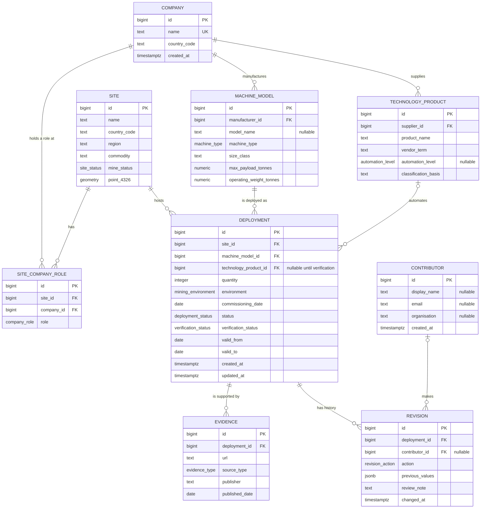

# Database Entity Relationship Diagram

## Purpose and scope

This is the proposed logical data model for the Autonomous Mining Equipment
Market Map.  It implements the MVP data requirements in SRS v0.2 (FR-01 to
FR-15), in particular the distinction between the manufacturer of a machine
and the supplier of its automation technology.

A **deployment** is the central business record: a quantity of one machine
model, at one mine site, using one automation technology product, for a stated
period.  A deployment represents a fleet where individual serial numbers are
not available.

## Logical ER diagram

## Relationship rules

| Relationship | Cardinality | Rule |
|---|---:|---|
| Company–machine model | 1:N | A model has one manufacturer; a company may manufacture many models. |
| Company–technology product | 1:N | A product has one supplier; the supplier may also be a machine manufacturer. |
| Site–company role | M:N | A site can have owners, operators and contractors.  The association table records the role. |
| Site–deployment | 1:N | Each deployment belongs to one mine site. |
| Machine model–deployment | 1:N | A model may occur in many deployments.  The model name may be unknown initially. |
| Technology product–deployment | 0..1:N | A submission may initially omit the product, but it is required before verification. |
| Deployment–evidence | 1:N | Evidence is stored separately so several supporting sources can be retained. |
| Deployment–revision | 1:N | Changes are append-only; the deployment row is the current state and revisions provide an audit trail. |

## Controlled values

The following should be PostgreSQL enums or lookup tables, not unconstrained
free text:

| Field | Values |
|---|---|
| `company_role` | `owner`, `operator`, `contractor` |
| `machine_type` | `haul_truck`, `lhd`, `dozer`, `excavator`, `drill`, `scaler`, `shotcrete_machine`, `other` |
| `automation_level` | `line_of_sight_remote`, `teleremote`, `semi_autonomous`, `autonomous` |
| `mining_environment` | `surface`, `underground`, `both` |
| `deployment_status` | `announced`, `commissioning`, `operational`, `decommissioned` |
| `verification_status` | `unverified`, `pending_review`, `verified`, `rejected` |
| `evidence_type` | `company_release`, `news`, `academic`, `government`, `report`, `other` |

The three user-facing automation bands are derived from `automation_level`:
baseline = line-of-sight remote; teleremote = teleremote; autonomy =
semi-autonomous or autonomous.  They should not be stored redundantly.

## Integrity constraints and indexes

* `quantity > 0`; latitude/longitude are not duplicated when `point_4326` is
  used.
* `valid_to` must be on or after `valid_from`; a relocation closes one
  deployment and creates another.
* A verified deployment requires a technology product and at least one evidence
  record.  Enforce this in the application transaction or a database trigger.
* `site_company_role` is unique on `(site_id, company_id, role)`.
* `machine_model` is unique on `(manufacturer_id, model_name)` where
  `model_name` is not null.
* Add B-tree indexes for deployment filters: `site_id`, `machine_model_id`,
  `technology_product_id`, `verification_status`, `status`,
  `commissioning_date`, and the site `country_code`.
* Add a GiST index on `site.point_4326` for viewport and radius queries.
* Store source URLs as text and optionally add a unique index on
  `(deployment_id, url)` to prevent duplicate evidence.

## Deliberate exclusions for the MVP

Machine serial numbers, ownership percentages, sensor-level details, raw
uploaded media and market-event feeds are not required by the MVP.  They can be
added later without changing the central deployment relationship.
