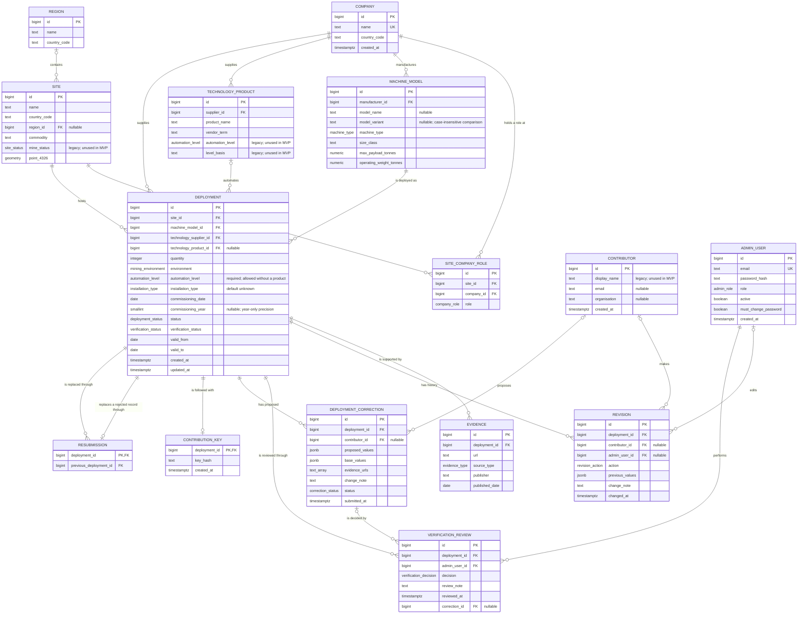

# Database Entity Relationship Diagram

## Purpose and scope

This is the proposed logical data model for the Autonomous Mining Equipment
Market Map.  It aligns to SRS v0.6: FR-01, FR-02, FR-04 to FR-08, FR-10,
FR-11 and FR-57 as committed scope, with FR-03, FR-12 to FR-14 and FR-56
intended. FR-09 is withdrawn. Migration 005 (#188, issue #171) implements the
supplier association below. In particular it holds
the manufacturer of a machine and the supplier of its automation technology as
separate values.

A **deployment** is the central business record: a quantity of one machine
model, at one mine site, using technology from one supplier and, where named,
one automation technology product, for a stated
period.  A deployment represents a fleet where individual serial numbers are
not available.

## Logical ER diagram



This diagram is the single maintained copy.  SRS Section 5.1 shows a rendered
image of it rather than a second copy of the source.  Regenerate the image
whenever the diagram changes:

```bash
awk '/^```mermaid/{f=1;next} f&&/^```/{exit} f' docs/database/ERD.md > /tmp/erd.mmd
mmdc -i /tmp/erd.mmd -o docs/images/erd.png -b white -w 2400 -s 2
```

## Relationship rules

| Relationship                   | Cardinality | Rule                                                                                                                                                                 |
| ------------------------------ | ----------- | -------------------------------------------------------------------------------------------------------------------------------------------------------------------- |
| Region–site                    | 0..1:N      | A site may sit in a named region, or in none.  Regions are reference data so that grouping and filtering resolve to one value (FR-12).                               |
| Company–machine model          | 1:N         | A model has one manufacturer; a company may manufacture many models.                                                                                                 |
| Company–technology product     | 1:N         | A product has one supplier; the supplier may also be a machine manufacturer.                                                                                         |
| Site–company role              | M:N         | A site can have owners, operators and contractors.  The association table records the role.                                                                          |
| Site–deployment                | 1:N         | Each deployment belongs to one mine site.                                                                                                                            |
| Machine model–deployment       | 1:N         | A model may occur in many deployments. New submissions must name it; imported records may omit the model name (SRS Section 5.2).                                                                                     |
| Technology supplier–deployment | 1:N         | Each deployment names one technology supplier directly, independently of whether a product is named. |
| Technology product–deployment  | 0..1:N      | A product is optional at every stage, including verification. If named, its supplier must match the deployment supplier. A deployment carries its own automation level; no placeholder product is created to carry it. |
| Deployment–evidence            | 1:0..N      | A deployment may initially have no evidence; verified deployments require at least one evidence record (see integrity constraints).                                  |
| Deployment–verification review | 1:N         | Every verification decision is retained as a separate, append-only review record.                                                                                    |
| Admin user–verification review | 1:N         | Each review is performed by one administrator; an administrator may perform many reviews.                                                                            |
| Deployment–revision            | 1:N         | Changes are append-only; the deployment row is the current state and revisions provide an audit trail.  A revision may be made by a contributor or by an admin user. |

## Controlled values

The following should be PostgreSQL enums or lookup tables, not unconstrained
free text:

| Field                   | Values                                                                                                                                                                                                                                   |
| ----------------------- | ---------------------------------------------------------------------------------------------------------------------------------------------------------------------------------------------------------------------------------------- |
| `company_role`          | `owner`, `operator`, `contractor`                                                                                                                                                                                                        |
| `site_status`           | `operating`, `commissioning`                                                                                                                                                                                                             |
| `machine_type`          | `haul_truck`, `lhd`, `loader`, `dozer`, `excavator`, `drill`, `scaler`, `shotcrete_machine`, `underground_haul_truck`, `water_truck`, `wheel_loader`, `crawler_loader`, `rock_breaker`, `skid_steer`, `strut_handler`, `shovel`, `other` |
| `automation_level`      | `operator_assistance`,  `teleremote`, `semi_autonomous`, `autonomous`                                                                                                                                             |
| `mining_environment`    | `surface`, `underground`, `both`                                                                                                                                                                                                         |
| `installation_type`     | `factory_installed`, `retrofit`, `unknown`                                                                                                                                                                                               |
| `deployment_status`     | `announced`, `commissioning`, `operational`, `decommissioned`                                                                                                                                                                            |
| `verification_status`   | `unverified`, `pending_review`, `changes_requested`, `verified`, `rejected`. `changes_requested` waits on the contributor after a `needs_changes` decision; `unverified` marks records loaded without review (migrations 006 and 007, #204) |
| `verification_decision` | `approved`, `rejected`, `needs_changes`                                                                                                                                                                                                  |
| `evidence_type`         | `company_release`, `news`, `academic`, `government`, `report`, `other`                                                                                                                                                                   |
| `revision_action`       | `create`, `update`, `verification_change`                                                                                                                                                                                                |
| `admin_role`            | `root`, `admin`                                                                                                                                                                                                                          |
| `correction_status`     | `pending`, `approved`, `rejected`, `needs_changes`                                                                                                                                                                                       |

### Automation level mapping

The labels in FR-57 map to `deployment.automation_level` as follows. The
contributor states the level and an administrator confirms it by approving
the record; no level is derived from the technology product. Product level
and basis columns are legacy and are not populated or used in the MVP.
Numeric source levels require a documented source-specific mapping; no
generic SAE-style mapping is assumed. Original source terminology is retained
in source files and import documentation.

| Source level        | `automation_level`    |
| ------------------- | --------------------- |
| Highly Autonomous   | `autonomous`          |
| Semi Autonomous     | `semi_autonomous`     |
| Teleremote          | `teleremote`          |
| Operator Assistance | `operator_assistance` |

## Normalisation rules

Controlled enum inputs are trimmed and matched case-insensitively against the
documented enum or source-level mapping before storage.  Values that match
neither an enum value nor a documented alias are rejected rather than guessed.

The following source labels are accepted as aliases for `machine_type`:

| Input (any case) | Stored value |
| ---------------- | ------------ |
| `Truck`          | `haul_truck` |
| `ROC`            | `other`      |

Machine-model variants follow separate rules:

1. The importer removes leading and trailing whitespace before insertion.
2. Empty, whitespace-only or absent values are stored as `NULL`, meaning
   unknown or not supplied. `base` is used only when the source explicitly
   identifies a base variant or synthetic test data intentionally models one.
3. Non-empty spelling and capitalisation are preserved for display.
4. Comparison and duplicate detection are case-insensitive.  For example, `i`
   and `I` identify the same variant, as do `K` and `k`.

Commissioning time is stored at the precision the source gives.  A year-only
source value sets `commissioning_year` and leaves `commissioning_date` NULL; no
month or day is invented.  A full date sets both.

`installation_type` is `unknown` unless a source states factory installation
or retrofit.  The client `Category` field (New / Upgrade) is not mapped to it
until #62 confirms that meaning.

## Integrity constraints and indexes

- `quantity > 0`; latitude/longitude are not duplicated when `point_4326` is used.  If PostGIS is unavailable, `point_4326` is replaced by latitude and longitude columns, which serve the point rendering and bounding-box queries the map requires.
- `valid_to` must be on or after `valid_from`; a relocation closes one deployment and creates another.
- `commissioning_date IS NULL OR commissioning_year = EXTRACT(YEAR FROM commissioning_date)`, with `commissioning_year` required whenever `commissioning_date` is present.
- `deployment.installation_type` is `NOT NULL DEFAULT 'unknown'`.
- New submissions require site, site country, manufacturer, machine type, machine model, positive quantity, technology supplier, automation level and disclosure acknowledgement (FR-07, FR-41). Model variant and technology product are optional. Enforce these requirements at the submission boundary.
- Every deployment requires a technology supplier and its own automation level: `technology_supplier_id` and `automation_level` are `NOT NULL` (FR-01, FR-57). Missing values must not be fabricated.
- A verified deployment additionally requires at least one evidence record. A technology product is optional even after verification (FR-08, FR-44). Enforce this in the application transaction or a database constraint/trigger, including on evidence removal.
- `deployment.technology_supplier_id` references `company(id)` directly. If a product is named, its supplier must match the deployment supplier. Enforce this with a composite foreign key to `technology_product(id, supplier_id)`, backed by a unique constraint, or an equivalent trigger.
- A verification review must reference an active administrator. Review records are append-only; `verification_status` represents the current verification state and is updated transactionally when a review decision changes it.
- A public correction to a verified deployment is a `deployment_correction` row; the deployment itself is unchanged until an administrator approves it (#114). `proposed_values` and `base_values` hold only the changed fields, keyed by API field name, with their proposed values and their values at submission. A correction changes at least one field or adds an evidence URL. Its row is never edited or deleted: only `status` changes, once, from `pending`. A review that decides a correction carries `correction_id`, and a composite foreign key on `(correction_id, deployment_id)` keeps both on the same deployment. Approval writes an `update` revision attributed to the correction's contributor.
- Every revision identifies exactly one actor: `CHECK ((contributor_id IS NOT NULL) <> (admin_user_id IS NOT NULL))` (FR-47). Administrator changes and bulk imports identify the administrator; public changes identify a contributor row, without requiring a contributor account. Neither an unknown actor nor two actors are allowed.
- `admin_user.email` is unique and stored in lower case. Store only a strong password hash (the backend uses scrypt), never a plaintext password.
- `admin_user.role` is `root` or `admin`. Root accounts are created only from the command line (`npm run admin:create -- --root`) and manage administrator accounts; administrators review submissions.
- `admin_user.must_change_password` is true while an account still has a generated temporary password; every other administrator action is refused until it is changed.
- A submission's private key (FR-59, #205) is held only as a SHA-256 hash in `contribution_key`, one row per submitted deployment, so public reads of `deployment` never carry it. The key is returned once when the submission is made; it lets the contributor follow the submission and answer a request for changes without an account. Deployments loaded without review have no row and are never reachable through the contributor API. The hash is 64 lowercase hex characters (`contribution_key_hash_format`).
- A resubmission (FR-60, #207) links a new deployment to the rejected deployment it replaces: one `resubmission` row per new deployment, while a rejected deployment may be replaced more than once. The rejected deployment stays closed; the link shows the reviewer the earlier decision and lets each record's history point to the other. It is accepted only with the rejected submission's key. `resubmission_not_itself` keeps a deployment from replacing itself.
- The MVP collects from a contributor only an optional email address and, where offered, an organisation (NFR-09). The legacy `display_name` column is retained but is not populated by MVP contribution flows. No domain-affiliation flag is held in the MVP; one arrives only if FR-52 and FR-53 are taken up.
- `company.name` is unique.
- `region` is unique on `(name, country_code)`.
- A site's country must match its region's country.  Enforce with a unique constraint on `region(id, country_code)` and a composite foreign key from `site` on `(region_id, country_code)`, or with a trigger.
- `site_company_role` is unique on `(site_id, company_id, role)`.
- `machine_model.model_variant` is nullable with no `base` default and `CHECK (model_variant IS NULL OR (model_variant = btrim(model_variant) AND model_variant <> ''))`. Capitalisation is preserved for display. This check rejects empty strings and surrounding spaces; the importer handles whitespace normalization before insertion.
- A case-insensitive unique index on `(manufacturer_id, model_name, COALESCE(lower(model_variant), ''))`, where `model_name` is not null, prevents duplicate named models, including those with an unknown variant.
- For unnamed models (`model_name IS NULL`), a unique index on `(manufacturer_id, machine_type, COALESCE(lower(model_variant), ''))` preserves deduplication per manufacturer, machine type and variant. The empty-string index value represents `NULL` only; stored empty variants are forbidden. Unknown and explicit `base` variants remain distinct.
- Add B-tree indexes for deployment filters: `site_id`, `machine_model_id`, `technology_supplier_id`, `technology_product_id`, `verification_status`, `commissioning_year`, and the site `country_code` and `region_id`. Migration 010 (#221) drops the indexes on `status`, `automation_level`, `installation_type` and `commissioning_date`: the filters compare these low-cardinality values as text, so the planner never used them. The year filters compare `commissioning_year`, which `deployment_commissioning_precision` fills whenever a date is recorded.
- Register search (`ILIKE '%text%'`) uses `pg_trgm` GIN indexes on `site.name`, `company.name`, `technology_product.product_name` and `machine_model.model_name`, matching each name table first and then deployments by key; a B-tree index on `site.name` serves the register's default order.
- Add B-tree indexes on `verification_review(deployment_id, reviewed_at)` and `verification_review(admin_user_id)` to support review history and audit queries.
- Add a B-tree index on `revision(deployment_id, changed_at)` to support revision history.
- Add a GiST index on `site.point_4326` for viewport and radius queries.
- Store source URLs as text.  A unique index on `(deployment_id, url)` prevents duplicate evidence and also serves evidence lookup by deployment.

## Deliberate exclusions for the MVP

Machine serial numbers, ownership percentages, sensor-level details, raw
uploaded media and market-event feeds are not required by the MVP.  They can be
added later without changing the central deployment relationship.
The mine site's own status and product level classification are not used in
the MVP; their legacy columns remain for compatibility (SRS Section 7).
