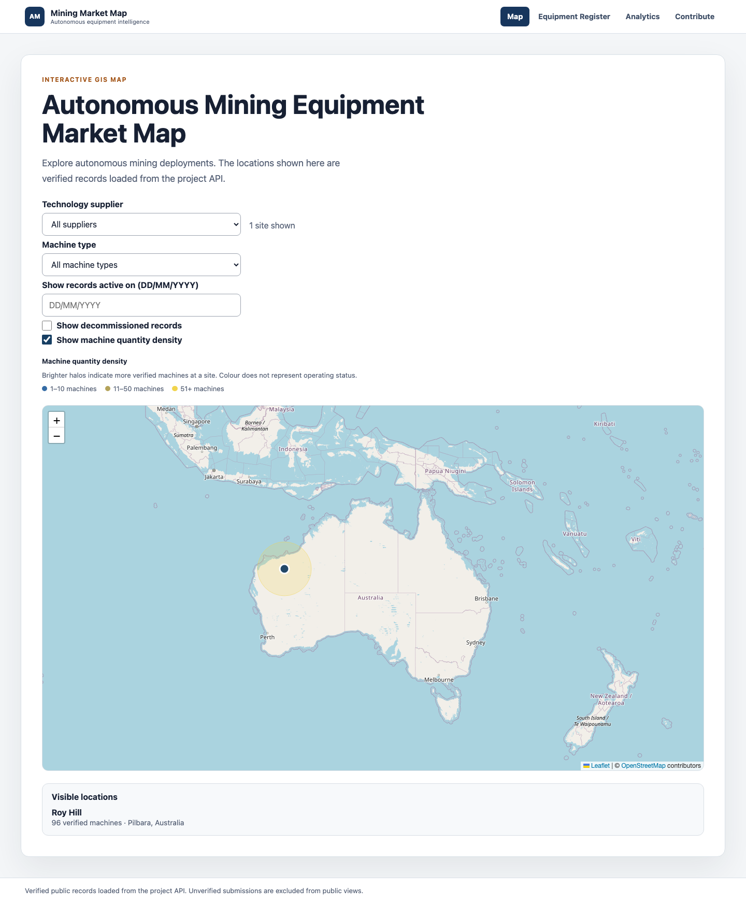
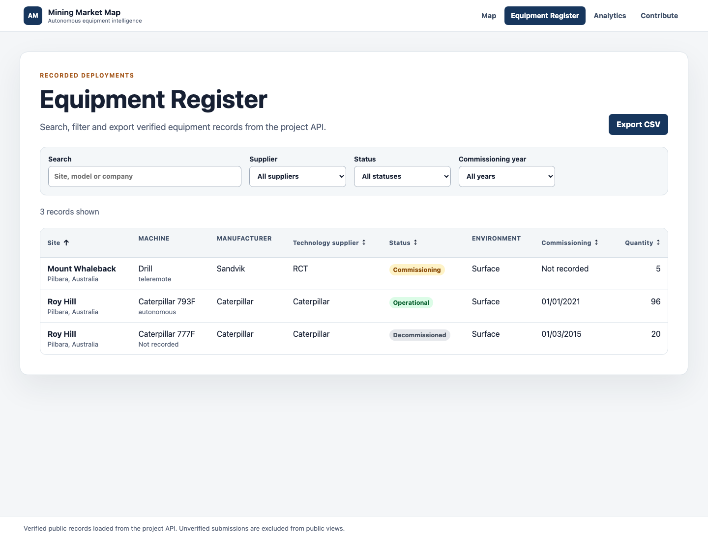
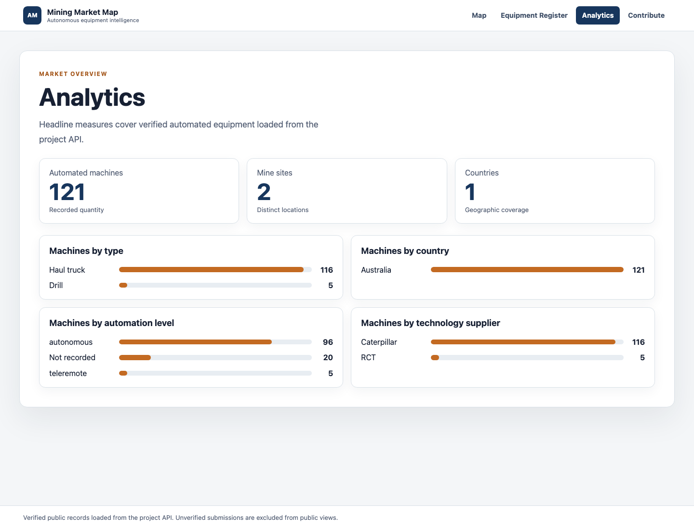

# Sprint 2 UI review snapshots

These screenshots were captured from the local frontend against the live project API on 20 September 2026.

## Map

The map defaults to operational records, provides an explicit decommissioned-record option, and uses a quantity-density halo without using colour to encode operating status.

## Equipment Register

The register uses keyword search, supplier/status/year filters, Australian-format commissioning dates, CSV export, and sortable table headers.

## Analytics

The analytics page shows verified headline counts plus breakdowns by machine type, country, automation level, and technology supplier.

