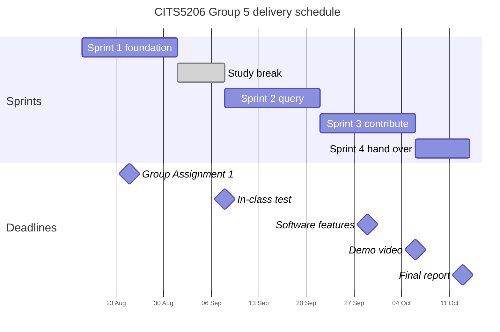

# Project Plan

Living document, updated as the project progresses. Section 3 of the Group
Assignment 1 report links here, so keep it current.

- **Project:** Autonomous Mining Equipment Market Map
- **Client:** Dr Adrian Boeing · **Representative users:** RCT Global, Epiroc
- **Facilitator:** Fudong Qin
- **Repository:** https://github.com/zinken7/capstone-group-5

**How this document is used.** Task-level truth lives in GitHub issues and
milestones. If this file and the issue tracker disagree, the tracker wins and
this file is updated.

---

## 1. Team Responsibilities

| Code | Member | Role | Area of ownership |
|---|---|---|---|
| M1 | Tyrone Tran (24814799) | DevOps and AI integration | Repository configuration, CI/CD, deployment environments, system integration, LLM verification and RAG pipeline |
| M2 | Hans Lionar (24661999) | Project coordination and business analysis | Requirements, planning and task allocation, client communication, project documentation and risk register, quality assurance |
| M3 | Zerun Zhang (24389925) | Backend development and API testing | Backend services, application logic, REST APIs, verification workflow, automated API tests |
| M4 | Zunhao Zhang (24758673) | Database development and data integration | Entity-relationship model and migrations, PostGIS and spatial queries, data ingestion and quality, evidence metadata, database testing and performance |
| M5 | Shee Wang (24368932) | Front-end, GIS and analytics | Public interface, interactive GIS map, analytics dashboard, submission and moderation interfaces, report interfaces |
| M6 | Hengan Weng (24201874) | Front-end, quality assurance and RAG evaluation | Front-end support, system and accessibility testing, RAG and report-accuracy evaluation, user and administrator guides, demonstration preparation |

[`accountability.md`](accountability.md) holds the full per-member detail, and
[`CONTRIBUTING.md`](../CONTRIBUTING.md) records the working conventions.

---

## 2. Timeline

| Milestone | Deliverable | Target date | Status |
|---|---|---|---|
| Project Spec and Plans | Submission PDF (group, 15%) | 25 Aug 2026 | Done |
| Sprint 1 increment | Map serving live data on staging | 31 Aug 2026 | Done |
| In-class test | Individual, 20% | 8 Sep 2026 | Outside project tracker |
| Sprint 2 increment | Register, filters, export, headline statistics | 21 Sep 2026 | Done |
| Software Features | Individual, 20% | 29 Sep 2026 | Outside project tracker |
| Professional Reflection | Individual, 15% | 29 Sep 2026 | Outside project tracker |
| Sprint 3 increment | Contribution and verification; deployed to staging | 5 Oct 2026 | In review |
| Demonstration video | Individual, 15% | 6 Oct 2026 | In progress |
| Final Project Report | Group, 15%, plus showcase | 13 Oct 2026 | In progress |
| Peer feedback | Feedback Fruits | 19 Oct 2026 | Not started |

---

## 3. Features and progress

Work is organised around the four functions agreed with the client, plus the
foundation they all sit on. Each feature is built as a vertical slice,
database, API and interface together, so that it is demonstrable when it is
done, rather than waiting on a later layer.

| ID | Feature | Capability delivered | Sprint | Status |
|---|---|---|---|---|
| F0 | Foundation | Schema, seed data, CI/CD and staging working together, shown by one mine site from the database appearing on the map | 1 | Done |
| F1 | Map | A visitor browses mine sites, sees deployment status, opens site detail, filters the map, and uses the time slider to view a past date | 1–2 | Done |
| F2 | Equipment register and export | A user searches, filters and sorts every record, and exports the dataset | 2 | Done |
| F3 | Analytics | A user reads headline statistics and market-level charts, with filters applying to every measure | 2–3 | Done |
| F4 | Contribute and verification | A contributor submits a record with evidence; an administrator verifies, rejects or requests more | 3 | Done |
| F5 | Deployment and handover | The system runs in the UWA environment and is handed over with documentation | 3–4 | In progress |

Status values: Not started · In progress · In review · Done. Update this table
at each sprint review; per-task status stays in the issue tracker. Individual
assessed work is submitted by each member and is not tracked in this repository.

### F0. Foundation (Sprint 1)

| # | Task | Owner | Depends on | Done when |
|---|---|---|---|---|
| 1 | Resolve open client questions: automation bands (Q-1a), UWA environment (Q-4) | M2 | Client response | Answers recorded in the SRS; any scope change documented and circulated |
| 2 | Schema and migrations from the merged ERD | M4 | 1 | Migrations run clean against staging; enums and constraints match `ERD.md` |
| 3 | Seed dataset loader | M4 | 2 | Client sample data, or a documented synthetic set, loads with one command |
| 4 | CI pipeline | M1 | none | Pull requests run lint, tests and build; failures block merge |
| 5 | Staging environment and deploy workflow | M1 | 4 | `main` deploys automatically; rollback documented |

**Dependency risk.** Task 2 depends on task 1. If Q-1a is not answered by 22
August, implement the four levels proposed in the SRS (FR-09, Sec. 2.6),
record the assumption, and raise it at the next client contact rather than
blocking.

### F1. Map (Sprints 1–2)

| # | Task | Owner | Depends on | Done when |
|---|---|---|---|---|
| 6 | Site and deployment read API | M3 | F0.2 | Endpoints return filterable records; contract documented |
| 7 | GeoJSON endpoint for markers | M3 | 6 | Returns site points with status and supplier for a bounding box |
| 8 | Markers rendered from the live API | M5 | 7 | Markers show status colour; supplier filter works against stored data |
| 9 | Site detail panel | M5 | 7 | Selecting a marker lists that site's deployments and technology suppliers |
| 10 | Further map filters | M5 | 8 | Country, region, machine type, automation level, commodity, surface/underground applied to the map (FR-20) |
| 11 | Time slider | M5 | 8 | The map shows only deployments in service at a selected date, and states how many records are excluded for want of a commissioning date (FR-19) |
| 12 | Manual test checklist and Sprint 1 smoke test | M6 | 8 | Checklist committed; the slice verified on staging by someone other than its author |

### F2. Equipment register and export (Sprint 2)

- Searchable, filterable, sortable register (FR-36)
- Export in a flattened tabular format (FR-37)
- *Should:* machine model detail with the deployments using it (FR-38)

### F3. Analytics (Sprints 2–3)

- Headline statistics: machines, sites, countries (FR-21)
- Cumulative machines in service over time (FR-22)
- Machine count by country and by machine type (FR-23, FR-24)
- Share by technology supplier and by manufacturer (FR-25, FR-26)
- Filters applying to every measure (FR-27)
- *Could:* user chooses which measures are displayed (FR-35)

### F4. Contribute and verification (Sprint 3)

- Submission form; records published immediately (FR-40, FR-42)
- Notice that contributors may submit only what they are permitted to disclose
  (FR-41)
- Verification status, verified records shown by default (FR-43)
- Evidence links attached to records (FR-44)
- Administration screen for review (FR-45)
- Correction of existing records (FR-46)
- *Should:* revision history with reversion; editing a verified record returns
  it to pending review (FR-47, FR-48)
- *Should:* automated-submission challenge to control spam (FR-51)

### F5. Deployment and handover (Sprints 3–4)

- Deployment to the UWA environment
- Acceptance walkthrough with the client; defect resolution
- Handover documentation and licences (CC BY 4.0 data, MIT code, pending Q-10)
- Final report and showcase presentation

The bullets above are capabilities, not tasks. Each is broken into database,
API, interface and test tasks at the start of the sprint that carries it, in
the same shape as F1. The capabilities are what the team analysed from the
requirements elicitation and the client meetings, and they are still awaiting
client validation, so they may change.

---

## 4. Sprint 3 planned vs actual

The Sprint 3 target was a deployed contribution-to-verification workflow,
database-backed public views and enough integration evidence to leave Sprint 4
for stabilisation, documentation and handover.

By 5 October 2026 the manual MVP loop was complete on `main`: public users can
submit new records and propose corrections with evidence; administrators can
review, correct, approve, reject or request changes; and verified records feed
the Map, Equipment Register, Analytics and CSV export through the shared
Drizzle data path. The Vercel frontend and backend use a Neon PostGIS database,
with automated migrations and health checks. The optional FR-55 evidence
checker remains separate from the manual decision path and does not block the
MVP.

Two planned assumptions changed during integration:

- The UWA hosting environment was not available, so the team retained the
  documented Vercel/Neon staging environment for the demonstration and kept a
  reproducible Docker Compose setup for handover.
- The runtime dataset is the deterministic synthetic seed. The anonymised
  client CSV is retained as source evidence rather than loaded directly at
  runtime; this avoids presenting incomplete or restricted source data as a
  complete public market dataset.

The remaining Sprint 3 release work is deployed workflow evidence,
keyboard/accessibility verification and the final demonstration record. Sprint
4 remains focused on those checks, defect resolution and handover rather than
new core functionality. Detailed acceptance evidence is recorded in issue #70,
[`staging.md`](staging.md) and
[`sprint-2-frontend-qa-checklist.md`](sprint-2-frontend-qa-checklist.md).

---

## 5. Backlog

Not committed. Pulled in only if the committed scope completes early, in
roughly this order. Priorities are the SRS ratings.

| Item | Priority | Notes |
|---|---|---|
| Share of machines at each automation level, overall and by country (FR-29) | Should | Extends the analytics view; no new data needed |
| Machines newly commissioned each year (FR-30) | Should | Needs commissioning dates populated |
| Manufacturers and suppliers ranked within a machine type (FR-31) | Should | Directly serves the supplier sales use case |
| Payload class breakdown within a machine type (FR-32) | Should | Depends on size class and payload being recorded (FR-13) |
| Machine count by company role (FR-33) | Should | Owner and operator reported separately |
| Linked media: case studies, articles, video (FR-49) | Should | Client interest; attaches to sites, companies, equipment |
| Contact route for bulk contributions (FR-50) | Should | Manual import, not self-service |
| Compound annual growth rate by country (FR-34) | Could | Undefined from a zero base; reported as absolute increase instead |
| User chooses which measures are displayed (FR-35) | Could | See Q-11 |
| Link from a machine model to the manufacturer's page (FR-39) | Could | Only where the page is known |
| Sign-in with Microsoft or Google; affiliation flag (FR-52, FR-53) | Could | Depends on outbound access (Q-4a) and a budget owner (Q-4c) |
| Market events feed (FR-54) | Could | Supplier changes, acquisitions, new products |
| Compare a mine site against similar sites (new, CM2) | Could | Raised by Epiroc at CM2 to support advising an operator from a comparable site. Not yet in the SRS; needs a requirement written before it can be scheduled |
| Automated evidence check (FR-55) | Could | Depends on outbound access and a budget owner; never decides a record's status |

---

## 6. Deployment Plan

Proposed by the team and to be confirmed by M1, who owns deployment. Section 4
of the report proposes Vercel for the front end and AWS for the backend and
database; the environments below should be reconciled with that once the UWA
environment is known (Q-4).

| Environment | Purpose | Platform | Deployed by |
|---|---|---|---|
| Local | Development | Docker Compose: application, PostgreSQL/PostGIS, seed data | Any member |
| Staging | Integration and client demonstration | Vercel (frontend and backend) and Neon PostgreSQL/PostGIS; see [`staging.md`](staging.md) | Vercel Git integration from `main` |
| Production | Handover | UWA-provided environment | M1, manual approval |

**Pipeline.** Staging: apply any new migrations, then merge to `main`; Vercel
builds and deploys the affected project. Rollback is Vercel Instant Rollback.
Production deploys to the UWA environment follow once it is known, with a
manual approval step.

**Contingencies** (the UWA environment is unconfirmed, Q-4):

- **Docker not permitted.** Install from system packages behind nginx under
  systemd; keep containers for local development.
- **PostGIS unavailable.** Store latitude and longitude columns; the MVP needs
  point rendering and bounding-box queries only.
- **Outbound access blocked.** Self-host map tiles; drop optional sign-in and
  the automated evidence check.
- **Environment arrives late.** Staging remains the demonstration environment;
  no milestone before Sprint 3 depends on it.

**Open before Sprint 3:** who administers the environment after handover, and
whether a budget exists for any recurring cost. Staging uses free tiers, the
`vercel.app` domains with Vercel-managed TLS, and Vercel environment variables
for secrets.
