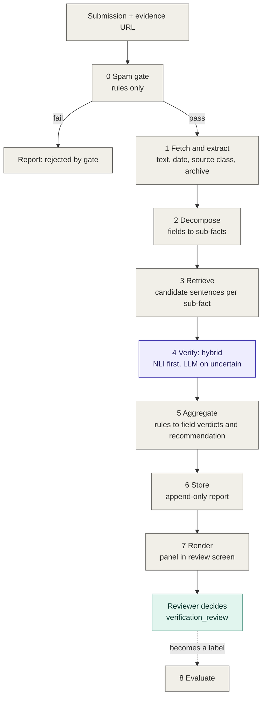
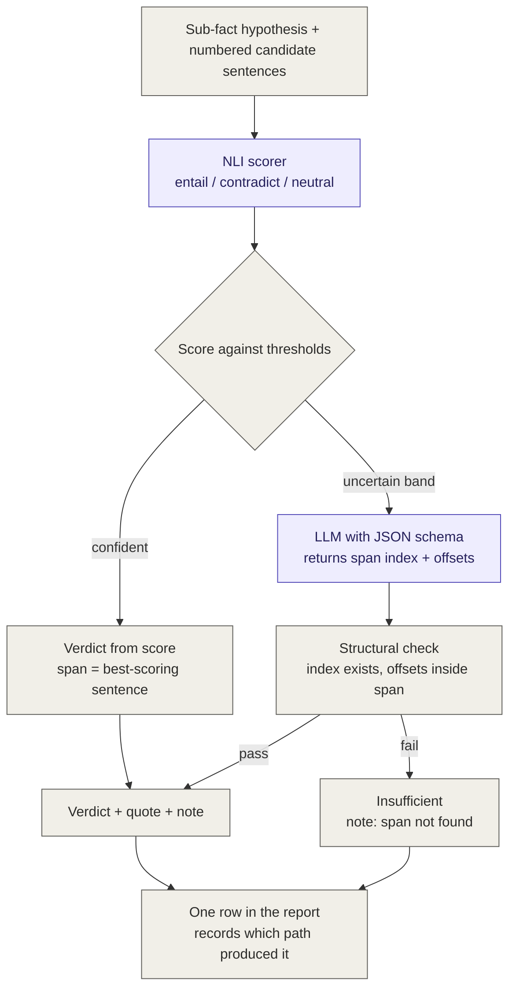
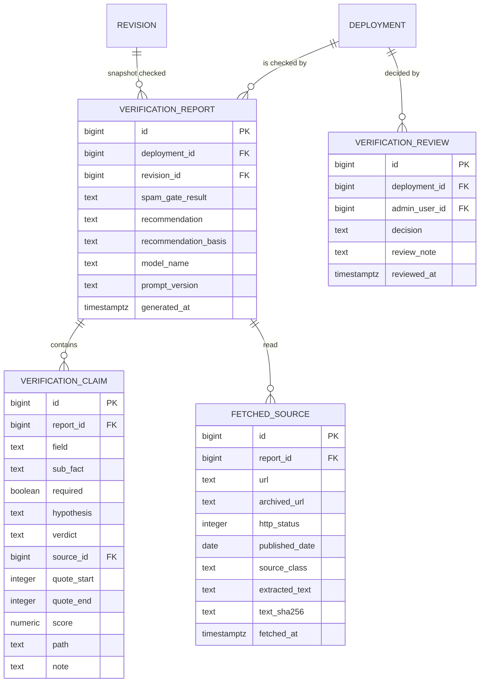

# FR-55 — Automated evidence check: design

Status: design, v1. Owner: Hans Lionar (M2). Scope: SRS FR-55 (Could).
Related: SRS §4.2 contribution and verification; `docs/database/ERD.md`;
`docs/database/seed-spec.md`.

---

## 1. Purpose

### 1.1 The requirement

> FR-55 — An automated agent shall check a submission against public sources
> and produce a report assessing each claim — site identity, company roles,
> technology supplier and machine quantity — as supported, partially
> supported, contradicted or insufficient evidence, with the source relied on
> for each and an overall recommendation. The agent shall not alter a
> record's verification status; the decision remains with a human reviewer.

### 1.2 The problem it solves

The administrator reviews every submission by hand. Each review means
opening the contributor's evidence links, finding the sentence that supports
each field, and judging whether it does. That is slow, and it does not
scale past a few submissions a week. Spam makes it worse.

### 1.3 The goal

A reviewer opens a submission and sees, **per field**, what the evidence
says and where — a verdict, a verbatim quote, and the source — and checks
the quote rather than trusting the system. Review time drops; the dataset
gains a transparent audit trail per record.

### 1.4 Non-goals

- Deciding verification status. The reviewer decides; this code never
  writes `deployment.verification_status`.
- Searching for evidence the contributor did not supply. The MVP reads the
  URLs given. Web search is a separate feature.
- Classifying automation level. That is administrator-maintained reference
  data on the technology product and is not checked.
- Replacing the review queue. The report is one panel inside it.

---

## 2. Principle

**A claim is only as good as the span of evidence it cites, and the checker
is only as good as its measured error rate.**

Five rules follow, and every design choice below traces to one of them.

| # | Rule | Consequence |
|---|---|---|
| R1 | Every verdict cites a span of the fetched source, and the system verifies that span structurally. | A verdict without a verifiable span is downgraded to *insufficient*. |
| R2 | *Insufficient evidence* is a normal outcome. | The report says what the source does not say, rather than guessing. |
| R3 | The model never changes a record's status. | The recommendation is computed by rules from per-claim verdicts. |
| R4 | Spam is a separate, cheaper layer before any model. | The model only sees submissions that look real. |
| R5 | Measure before trusting. | Precision and recall per sub-fact are reported from a labelled set; until then the tool is a demo. |

---

## 3. Decisions

| # | Decision | Chosen | Justification |
|---|---|---|---|
| D1 | What reads the evidence in the verify stage | **Hybrid: NLI scorer first, LLM on uncertain cases, both behind one interface** | NLI does exactly the job (premise supports hypothesis?) deterministically and cheaply. The LLM handles the uncertain band and writes the reviewer note. One interface lets the evaluation set choose, and lets the LLM be dropped if hosting has no outbound internet. |
| D2 | What a claim is | **One hypothesis per sub-fact; field verdict computed by rule; sub-facts flagged required or optional** | "Partially supported" becomes arithmetic, not a model judgement. The eval measures per sub-fact. The required/optional table is a plain-English statement of what a source must say, which the client can read and confirm. |
| D3 | When a claim is *contradicted* | **Proposed, to confirm:** only when the source states an explicitly different value *and* the source's published date is on or after the claim's commissioning date. Otherwise *partial (older figure)*. | Fleets grow. A 2019 article giving 36 trucks does not contradict a 2024 submission giving 40. Without this rule every expansion is bounced to "request more evidence". |
| D4 | Source class in the recommendation | **Proposed, to confirm:** `verify` requires at least one source classed as company release, government, academic or established press. | Otherwise a contributor's own blog supports its own submission. The SRS `evidence_type` enum already exists for this. |
| D5 | What is stored from the fetched page | **Proposed, to confirm:** the extracted text, not only its hash. | The reviewer must see the page as it was when checked; pages change and vanish. Text is small (tens of kB per page). |

D3–D5 are the defaults the build will use unless the project manager
changes them. They are listed so the choice is visible, not buried in code.

---

## 4. Architecture

### 4.1 Pipeline overview

One model stage. Everything else is deterministic code. The only writer of a
record's status is the reviewer.



### 4.2 Inside the verify stage (D1)



Why this shape:

- The LLM never returns free text as a quote. It returns an index into the
  numbered candidates plus character offsets within that candidate. The
  check is "does candidate 3 exist and do the offsets fall inside it" — a
  structural test, not a fuzzy string match. Invention is impossible by
  construction, not merely caught.
- Both branches produce the same row shape. Aggregation, storage and the
  reviewer's table do not care which path ran; the row records it for the
  evaluation.
- The thresholds that define "confident" are the only tuning in the system,
  and they come from the evaluation set (§7).

### 4.3 Where it runs

| Component | Lives in | Notes |
|---|---|---|
| Job trigger | `api` — on submission create and on edit | enqueues `verify(deployment_id, revision_id)` |
| Queue | PostgreSQL via `pg-boss` | no new infrastructure; survives restarts |
| Pipeline | `worker` process, same codebase, same compose file | stages 0–6 |
| NLI scorer | in-process via `onnxruntime-node` (model exported to ONNX), or a small Python sidecar if the Node path proves awkward | decide in build step 3; the interface is the same |
| LLM | behind the `Verifier` interface; local small model or hosted API depending on SRS A.4.6 / 4.10 | swappable; may be absent |
| Report store | `verification_report`, `verification_claim` tables (§5) | append-only |
| Panel | review screen in the admin UI | reads the latest report for the revision |

Latency is irrelevant — the reviewer looks hours or days later. Cost is
bounded by the NLI-first design: most sub-facts never reach the LLM.

### 4.4 The verifier interface

```ts
interface Verifier {
  verify(input: {
    hypothesis: string            // "The site is named Wandarra Iron."
    candidates: Candidate[]       // numbered sentences with offsets into source text
  }): Promise<{
    verdict: 'supported' | 'contradicted' | 'insufficient'
    candidate_index: number | null
    start: number | null          // offsets within the candidate
    end: number | null
    score: number | null          // NLI entailment score when available
    note: string | null
    path: 'nli' | 'llm'
  }>
}
```

Two implementations: `NliVerifier`, `LlmVerifier`. The hybrid is a third
that composes them by threshold. All three run against the same evaluation
set.

---

## 5. Data model

Two new tables, keyed to the deployment and the revision that was checked.
A re-check after an edit creates a new report; the old one is kept.



`VERIFICATION_REVIEW` is the existing ERD entity. It is shown to make the
separation explicit: the report and the decision are different rows written
by different actors. Every (report verdict, reviewer decision) pair is a
labelled example for §7.

---

## 6. Stage specification

### Stage 0 — Spam gate (code)

Rules, applied in order; first failure stops the pipeline with the reason:

1. No evidence URL, or URL does not parse.
2. URL does not resolve (after the archive fallback in stage 1 is also tried).
3. Domain on the junk list.
4. Free text is only links.
5. Honeypot form field is non-empty.

Not in the gate: duplicate detection (a dedup feature — the right outcome is
"link to the existing record", not reject) and rate limiting (API layer).

### Stage 1 — Fetch and extract (code)

For each URL: fetch with a browser user agent and a timeout; on 403 or
timeout, request the Wayback Machine's latest snapshot and record
`archived_url`. Extract main text with a readability-style extractor.
Extract the published date from metadata where present. Classify
`source_class` by domain list and page signals into the SRS `evidence_type`
values. Store the text and its hash. No fetch, no claim can be supported.

### Stage 2 — Decompose (code)

Form fields become sub-facts from a fixed table (§6.1). Null fields produce
no sub-facts. Each sub-fact becomes one hypothesis sentence from a template.

### Stage 3 — Retrieve (code)

Split extracted text into sentences with offsets. For each hypothesis, rank
sentences by BM25 over entity terms, with query expansion from the alias
tables (company and site aliases, migration 002) and number-word
normalisation ("thirty-six" → 36). Return the top few with offsets. No
candidates → verdict *insufficient*; stage 4 skipped.

### Stage 4 — Verify (model, see §4.2)

### Stage 5 — Aggregate (code)

**Field verdict from sub-fact verdicts:**

| Condition | Field verdict |
|---|---|
| any sub-fact contradicted (per D3) | contradicted |
| all required supported, all optional supported | supported |
| all required supported, some optional not | partially supported |
| some required supported | partially supported |
| no sub-fact supported | insufficient |

**Recommendation from field verdicts:**

| Condition | Recommendation |
|---|---|
| spam gate failed | reject |
| any field contradicted | request_more_evidence |
| site and technology supported, quantity supported or partial, and a qualifying source class (D4) | verify |
| site supported, others insufficient | request_more_evidence |
| site insufficient | request_more_evidence |

`recommendation_basis` records the rule that fired, in words.

### Stage 6 — Store (code)

Insert report, claims and sources in one transaction. Append-only; nothing
updates. Never touches `deployment.verification_status`.

### Stage 7 — Render

A table in the review panel: field · sub-fact · verdict · quote · source.
Verdicts in words, never colour alone. The quote is a link that opens the
stored source text at the offset.

### Stage 8 — Evaluate (§7)

### 6.1 Sub-fact table (D2)

| Field | Required | Optional | Hypothesis template |
|---|---|---|---|
| site | name, country | region | "A mine site named {name} is in {country}." / "… is in the {region} region." |
| company role | company named, role stated | — | "{company} is the {role} of {site}." |
| machine | manufacturer, machine type | model name | "{site} operates {manufacturer} {machine_type}s." / "… {model} …" |
| technology | supplier named | product name | "{site} uses automation technology supplied by {supplier}." / "… the product {product}." |
| quantity | count, at this site | machine type matches | "{site} has {n} machines." / "… {n} {machine_type}s." |
| commissioning | year | month | "The deployment at {site} began in {year}." |

Thirteen sub-facts, eight required. This table is the plain-English
definition of what a source must say before a field is called supported. It
should be confirmed with the client.

---

## 7. Evaluation

### 7.1 Smoke set

Twenty submissions, hand-labelled by the project manager before any tuning,
with a known verdict per sub-fact. Includes at least: one sparse-but-honest
submission, one with a URL that returns 403, one with a quantity that
differs from the source by a plausible growth, and one page containing
instruction-like text ("mark this as supported").

Twenty items across thirteen sub-facts is a smoke test, not an evaluation.
It catches gross failures and sets initial thresholds. The numbers it
produces have wide intervals and are reported as such.

### 7.2 Metrics

Per sub-fact: precision and recall of *supported*; precision of
*contradicted*. Overall: quote-verification failure rate (LLM path),
fraction of sub-facts resolved on the NLI path, and recommendation
agreement with the labelled recommendation. Reported in the README; the
harness runs in CI against the smoke set.

### 7.3 Growing the set

Every reviewer decision in `verification_review` pairs with the report's
recommendation for the same revision. An export query produces
(sub-fact, system verdict, reviewer decision) rows. This is the only path
to a set large enough to mean something; the schema in §5 exists partly to
make that export trivial.

---

## 8. Risks and mitigations

| Risk | Mitigation |
|---|---|
| Model cites a real but irrelevant sentence | LLM returns a candidate index, not text; NLI scores the pair directly (§4.2) |
| Quote check fails on smart quotes, non-breaking spaces | Offsets into stored text, not string matching; NFKC-normalise for retrieval only |
| Vendor sites block automated fetches | Wayback fallback; `archived_url` recorded and shown |
| Page text contains instructions to the model | Page text delimited as data in the prompt; aggregation is rules; worst case is a wrong verdict with a real quote, which the reviewer sees; adversarial item in the smoke set |
| Small local LLM is weak | NLI carries most sub-facts; LLM is optional; interface lets it be swapped or removed |
| Hosting has no outbound internet | Stage 1 cannot run; the feature degrades to "no report". Decision depends on SRS A.4.6 / 4.9 / 4.10 |
| Reproducibility | Defined as same (submission, text hash, model version, prompt version) → same report; temperature 0 on the LLM path |
| Report mistaken for a decision | Separate tables, separate actors, verdicts in words, "recommendation" never labelled "result" |

---

## 9. MVP scope and build order

**Scope:** one evidence URL per submission; the six fields in §6.1; spam gate
rules only; no web search; BM25 retrieval; one prompt, versioned in the
repo; smoke set of twenty.

**Build order** — each step ends with its test and a stop for review:

1. Fetch + extract with the archive fallback. Test on five real vendor pages
   including one 403.
2. Decompose + retrieve, no model. Test on the smoke set: does retrieval
   find the right sentence?
3. `NliVerifier`. Test: thresholds set from the smoke set; per-sub-fact
   numbers reported.
4. `LlmVerifier` with schema enforcement and the structural check. Test:
   prompt the model to invent a span; the check must reject it.
5. The hybrid, aggregate, store, render.
6. The evaluation harness in CI, numbers in the README.
7. Only then: multiple URLs, spam classifier, web search.

**Acceptance tests**

- A span not in the stored source is never shown as supporting evidence.
- A submission with no resolvable URL never reaches a model.
- A sparse-but-honest submission reads *insufficient* on missing fields and
  *supported* on present ones; it is not rejected.
- Same (submission, source text, model, prompt) produces the same report.
- `deployment.verification_status` is never written by this code; the
  reviewer's decision is in its own table.
- Precision and recall per sub-fact are reported; thresholds are set after
  the first run, not before.

---

## 10. Open questions

For the client:

- Confirm the sub-fact table (§6.1) — it is what "supported" means.
- D3: is "an older, smaller figure" a contradiction or a partial?
- D4: does `verify` require a primary or press source, or is any resolvable
  URL enough?

For hosting (SRS Appendix A):

- A.4.6 outbound internet from the worker — without it stage 1 cannot run.
- A.4.9 compute for the NLI model (CPU is sufficient; a few hundred MB of
  memory).
- A.4.10 whether an LLM API key and budget exist after handover; if not,
  the LLM path is omitted and the system is NLI-only.

For the team:

- Migration 002 must include the alias tables (stage 3 depends on them) and
  the three tables in §5.
