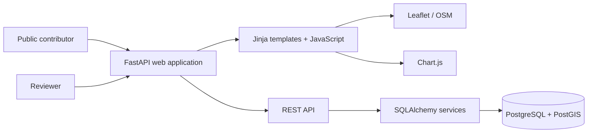
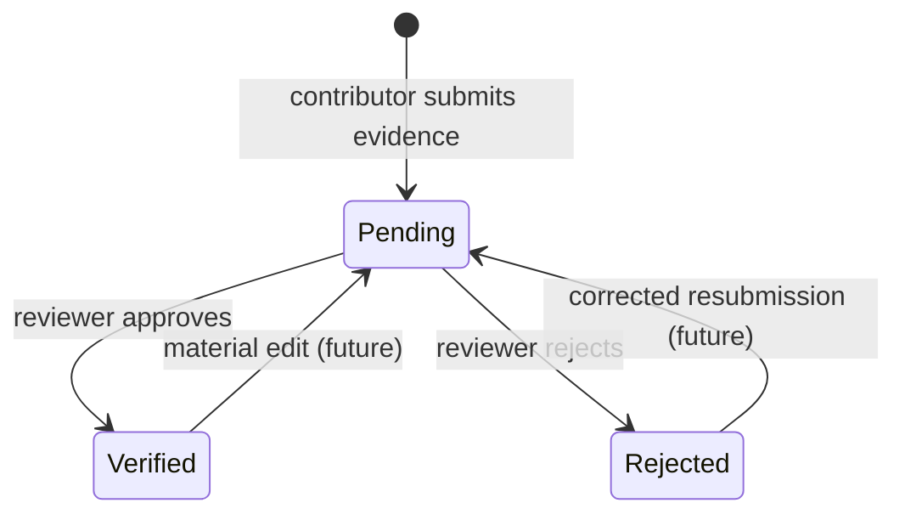

# MVP Architecture

## Design goals

- Deploy on a normal UWA Linux VM with Docker.
- Keep operating cost and maintenance low.
- Make evidence and verification first-class concepts.
- Preserve a clean API boundary for a future SPA or mobile client.
- Use PostgreSQL/PostGIS for spatial indexing and radius queries.

## Components

## Trust workflow

Only verified records are shown by default in public search, maps and analytics.

## Deployment boundary

The web container is the only public application component. PostgreSQL should remain on a private Docker network or protected host port. A UWA-managed reverse proxy should terminate HTTPS in production.
